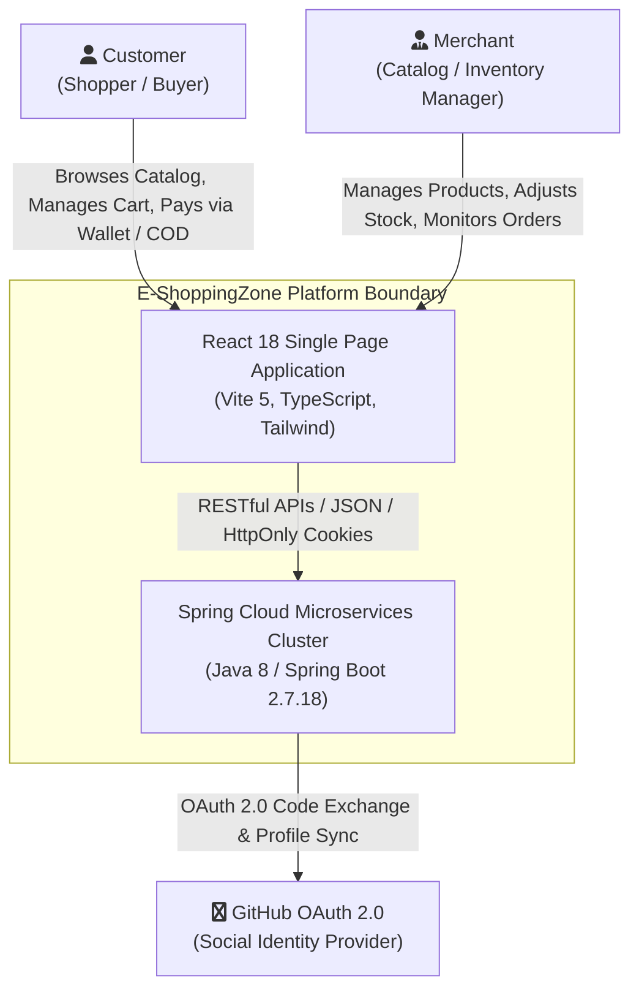
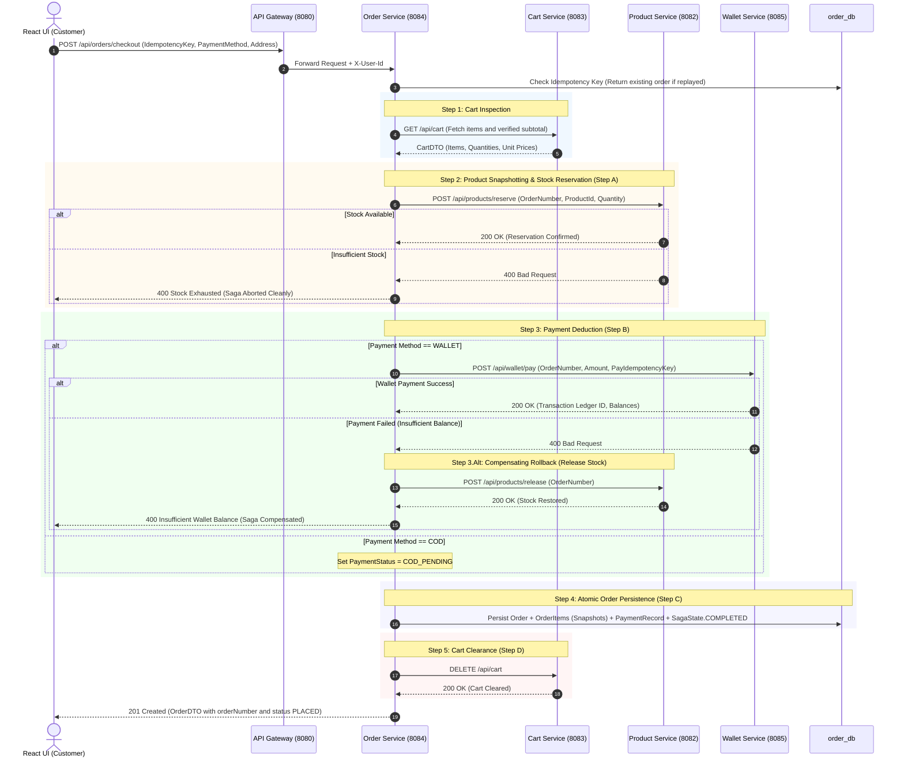
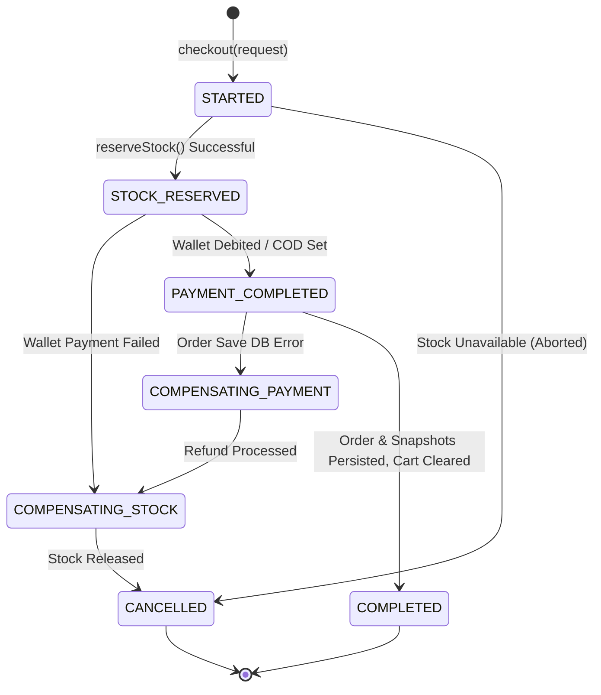
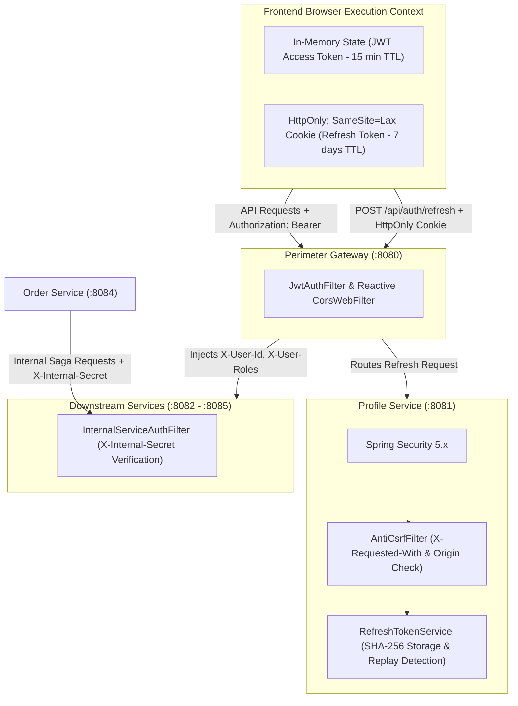

# E-ShoppingZone System Architecture & Technical Design Specification

[](https://www.oracle.com/java/)
[](https://spring.io/projects/spring-boot)
[](https://spring.io/projects/spring-cloud)
[](https://react.dev/)
[](https://www.mysql.com/)

---

## 1. Executive Architecture Summary

**E-ShoppingZone** is an enterprise-grade distributed e-commerce microservices platform built strictly against the Capgemini Case Study specification. The platform is architected around domain-driven design (DDD), database-per-service isolation, edge-routed perimeter security, asynchronous/synchronous microservice coordination, and an orchestrated distributed Saga state machine guaranteeing ACID-like data consistency without distributed two-phase locking (2PC).

### 1.1 Strict Technology Baseline & Runtime Constraints
- **Backend Runtime**: Pure **Java 8 bytecode** (`major version: 52`), compiled with target/source `1.8`.
- **Framework Stack**: **Spring Boot 2.7.18**, **Spring Cloud 2021.0.9 (Kilburn SR9)**, and **Hibernate 5.6.x**.
- **Frontend Stack**: **React 18.3.1**, **TypeScript 5.x**, **Vite 5**, **Tailwind CSS 3.4**, and **Axios 1.7**.
- **Databases**: **MySQL 8.4** across 5 isolated physical schemas (`profile_db`, `product_db`, `cart_db`, `order_db`, `wallet_db`).
- **Deployment Topology**: Bare-metal / native Windows service execution without Docker or Kubernetes dependencies.

---

## 2. C4 Architecture Models

### 2.1 C4 Level 1: System Context Diagram
The system context illustrates how external actors (Customers, Merchants, Administrators, and GitHub OAuth) interact with the E-ShoppingZone boundary.



---

### 2.2 C4 Level 2: Container Diagram
The container model exposes the runtime applications, protocols, and data stores comprising the platform.

```mermaid
flowchart TB
    Browser["Web Browser Client<br/>(React 18 SPA @ Port 5173)"]

    subgraph Infrastructure ["Platform Infrastructure"]
        Eureka["Eureka Discovery Registry<br/>(Netflix Eureka @ Port 8761)"]
        Gateway["Spring Cloud Gateway<br/>(Perimeter Edge Gateway @ Port 8080)"]
    end

    subgraph Microservices ["Autonomous Microservice Applications"]
        ProfileSvc["Profile Microservice<br/>(Port 8081)"]
        ProductSvc["Product Microservice<br/>(Port 8082)"]
        CartSvc["Cart Microservice<br/>(Port 8083)"]
        OrderSvc["Order Microservice<br/>(Port 8084)"]
        WalletSvc["Wallet Microservice<br/>(Port 8085)"]
    end

    subgraph Databases ["Database-Per-Service Schemas (MySQL 8.4 @ Port 3306)"]
        ProfileDB[("profile_db")]
        ProductDB[("product_db")]
        CartDB[("cart_db")]
        OrderDB[("order_db")]
        WalletDB[("wallet_db")]
    end

    Browser -->|HTTP / REST (Port 8080)| Gateway
    Gateway -.->|Service Resolution| Eureka
    ProfileSvc -.->|Heartbeat Registration| Eureka
    ProductSvc -.->|Heartbeat Registration| Eureka
    CartSvc -.->|Heartbeat Registration| Eureka
    OrderSvc -.->|Heartbeat Registration| Eureka
    WalletSvc -.->|Heartbeat Registration| Eureka

    Gateway -->|/api/auth/**, /api/profile/**| ProfileSvc
    Gateway -->|/api/products/**, /api/categories/**| ProductSvc
    Gateway -->|/api/cart/**| CartSvc
    Gateway -->|/api/orders/**| OrderSvc
    Gateway -->|/api/wallet/**| WalletSvc

    ProfileSvc -->|JPA / JDBC| ProfileDB
    ProductSvc -->|JPA / JDBC| ProductDB
    CartSvc -->|JPA / JDBC| CartDB
    OrderSvc -->|JPA / JDBC| OrderDB
    WalletSvc -->|JPA / JDBC| WalletDB

    CartSvc -->|Synchronous RestTemplate| ProductSvc
    OrderSvc -->|Synchronous RestTemplate| CartSvc
    OrderSvc -->|Synchronous RestTemplate| ProductSvc
    OrderSvc -->|Synchronous RestTemplate| WalletSvc
```

---

### 2.3 C4 Level 3: Microservice Component Breakdown

| Microservice | Port | Database | Key Architectural Responsibilities |
| :--- | :---: | :---: | :--- |
| **Discovery Server** | `8761` | None | Netflix Eureka Registry providing dynamic service discovery, self-preservation tuning, and live topology coordination. |
| **API Gateway** | `8080` | None | Spring Cloud Gateway edge router, reactive CORS filter, distributed correlation ID injection (`X-Correlation-Id`), perimeter JWT validation, and claims forwarding. |
| **Profile Service** | `8081` | `profile_db` | Spring Security 5.x, BCrypt hashing, JWT generation, opaque refresh token rotation (RTR) with replay detection, GitHub OAuth 2.0 integration, and anti-CSRF filter. |
| **Product Service** | `8082` | `product_db` | Catalog management, multi-criteria search, category hierarchies, `@Version` optimistic inventory locking, and Saga stock reservation/release. |
| **Cart Service** | `8083` | `cart_db` | Customer cart lifecycle, line item aggregation, live price verification against Product Service, subtotal calculations, and anti-IDOR customer isolation. |
| **Wallet Service** | `8085` | `wallet_db` | Financial transaction ledger, `@Lock(LockModeType.PESSIMISTIC_WRITE)` balance deductions, deposit simulation, internal payment/refund Saga endpoints, and idempotency key gate. |
| **Order Service** | `8084` | `order_db` | Checkout Saga orchestrator, immutable order snapshots, payment method dispatch (Wallet vs COD), compensating rollbacks, crash reconciliation, and merchant order visibility. |

---

## 3. Distributed Saga State Machine & Checkout Orchestration

The platform implements an **orchestrated distributed Saga pattern** inside `OrderServiceImpl` and `CheckoutSagaOrchestrator` to ensure transactional consistency across `cart-service`, `product-service`, `wallet-service`, and `order-service` without distributed locking or two-phase commit (2PC).

### 3.1 Checkout Saga Flow & Sequence Diagram



---

### 3.2 Saga State Machine Transitions



### 3.3 Crash Recovery & Background Saga Reconciliation
A distributed system can experience a process crash, network partition, or VM restart midway through an orchestration. The E-ShoppingZone Saga addresses intermediate failures via `OrderServiceImpl.reconcilePendingSagas()`:

1. **Recovery Target**: Orders stuck in non-terminal states (`STARTED`, `STOCK_RESERVED`, `COMPENSATING_STOCK`, `COMPENSATING_PAYMENT`) older than 60 seconds.
2. **Intermediate Recovery Logic for `STOCK_RESERVED`**:
   - The orchestrator queries `wallet-service`: `GET /api/wallet/payment/order/{orderNumber}`.
   - **Forward Recovery**: If the wallet service confirms deduction, the orchestrator completes order creation, sets `OrderStatus.PLACED`, marks `SagaState.COMPLETED`, and deletes the customer's cart.
   - **Backward Recovery**: If the wallet service has no deduction record, the orchestrator issues a compensating stock release to `product-service` (`POST /api/products/release`), marks `OrderStatus.CANCELLED`, and finalizes `SagaState.COMPENSATION_COMPLETED`.
3. **Execution Mechanism**:
   - Automated Spring `@Scheduled` worker periodically scans the database.
   - On-demand internal administrative endpoint: `POST /api/orders/reconcile`, strictly guarded by `X-Internal-Secret`.

---

## 4. Concurrency, Locking & Financial Ledger Integrity

E-Commerce platforms face race conditions during high-volume flash sales (inventory overselling) and rapid concurrent checkouts (wallet balance overdrafts).

### 4.1 Digital Wallet Pessimistic Locking
To prevent negative balances and double-spend race conditions under concurrent requests:
```java
@Lock(LockModeType.PESSIMISTIC_WRITE)
@Query("SELECT w FROM Wallet w WHERE w.userId = :userId")
Optional<Wallet> findByUserIdForUpdate(@Param("userId") Long userId);
```
- **Execution Mechanism**: Translates to native MySQL `SELECT ... FOR UPDATE`, acquiring an exclusive row lock on the user's wallet record.
- **Transactional Boundary**: Balance calculation, boundary check (`balance.compareTo(amount) >= 0`), balance decrement, and insertion into the immutable `wallet_transactions` ledger execute within a single Spring `@Transactional` block.
- **Financial Precision**: All monetary values are strictly represented as `java.math.BigDecimal` mapped to MySQL `DECIMAL(12,2)` with `RoundingMode.HALF_UP`. Float or double primitives are prohibited.

### 4.2 Product Inventory Optimistic Locking
Product stock updates employ Hibernate's `@Version` concurrency control:
```java
@Entity
@Table(name = "inventories")
public class Inventory {
    @Version
    private Long version;
    private Integer availableQuantity;
    private Integer reservedQuantity;
    // ...
}
```
- **High-Concurrency Scalability**: Prevents dirty reads and lost updates without blocking concurrent catalog browsing.
- If two transactions attempt to reserve the final item simultaneously, the first commit increments the version; the second transaction encounters an `OptimisticLockException`, triggering a rollback and preventing overselling.

---

## 5. Security Perimeter, Authentication & Token Lifecycles



### 5.1 Refresh Token Rotation (RTR) & Replay Attack Defense
1. **Opaque Tokens**: Cryptographically random 64-character tokens; never raw JWTs.
2. **SHA-256 Storage**: MySQL `refresh_tokens` stores only the SHA-256 hash of the token. A stolen database backup yields no valid refresh tokens.
3. **Single-Use Rotation**: On every `/api/auth/refresh` call, the presented token is revoked (`revoked = TRUE`), and a brand-new refresh token is generated and returned via `Set-Cookie`.
4. **Replay Detection**: If a client attempts to refresh using a token that has already been revoked (`revoked == TRUE`), the system flags an active replay attack. The security engine instantly revokes **all** active tokens in the user's family tree (`UPDATE refresh_tokens SET revoked = TRUE WHERE user_id = :userId`), invalidating the attacker and the victim and forcing re-authentication.

### 5.2 Anti-CSRF Defense
Because refresh tokens are delivered via cookies, `AntiCsrfFilter` defends against Cross-Site Request Forgery:
- Requires custom header `X-Requested-With: XMLHttpRequest` on cookie-bearing endpoints (`/api/auth/refresh`, `/api/auth/logout`, `/api/auth/logout-all`).
- Enforces strict `Origin` header whitelisting against `http://localhost:5173` and `http://localhost:8080`.
- Standard browsers strictly prohibit cross-origin requests from setting custom headers without explicit CORS preflight permission (`Access-Control-Allow-Headers`).

### 5.3 Internal Service-to-Service Defense
Internal Saga endpoints (`/api/products/reserve`, `/api/products/release`, `/api/wallet/pay`, `/api/wallet/refund`, `/api/orders/reconcile`) are protected by `InternalServiceAuthFilter`. Direct caller requests lacking a valid `X-Internal-Secret` matching the configured backend master secret receive an immediate `401 Unauthorized` or `403 Forbidden`.

---

## 6. Service Discovery & Load-Balanced Inter-Service Communication

```mermaid
flowchart LR
    subgraph Registry ["Netflix Eureka Server (8761)"]
        Dashboard["Eureka Service Catalog"]
    end

    subgraph Callers ["Calling Services"]
        Cart["Cart Service (8083)"]
        Order["Order Service (8084)"]
    end

    subgraph Targets ["Target Services"]
        Product["Product Service (8082)"]
        Wallet["Wallet Service (8085)"]
    end

    Cart -.->|1. Fetch Product Instances| Dashboard
    Order -.->|1. Fetch Target Instances| Dashboard
    Cart -->|2. HTTP GET http://product-service/api/products/{id}| Product
    Order -->|2. HTTP POST http://wallet-service/api/wallet/pay| Wallet
```

### 6.1 Fast Failover Tuning
Standard Eureka client configurations poll registry updates every 30 seconds, causing stale routing during dynamic restarts. E-ShoppingZone applies optimized discovery tuning:
- `eureka.client.registry-fetch-interval-seconds: 5`
- `spring.cloud.loadbalancer.cache.ttl: 3s`
- Downstream endpoints recover dynamically within 5 seconds of restart without manual intervention.

---

## 7. Zero-Trust Customer Isolation (Anti-IDOR)

Insecure Direct Object Reference (IDOR) vulnerabilities are eliminated across every tier:
1. **Never Trust Client Identifiers**: Endpoints never accept `customerId` in query parameters or request bodies.
2. **Gateway Extraction**: The perimeter API Gateway extracts the authenticated `userId` and `roles` from the verified JWT and forwards them in trusted internal headers (`X-User-Id`, `X-User-Roles`).
3. **Downstream Enforcement**: Downstream controllers extract caller identity via `@AuthenticationPrincipal` or `X-User-Id`. Cart, Wallet, and Order queries filter strictly by this authenticated ID.
4. **404 vs 403 Obfuscation**: If a customer requests `GET /api/orders/{id}` for an order belonging to another customer, the service returns `404 Not Found` rather than `403 Forbidden`, preventing resource enumeration attacks.

