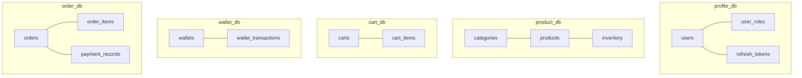

# E-ShoppingZone — Database Architecture & Schema Specification

**Document Version:** 1.0.0  
**Target RDBMS:** MySQL 8.4 Community Server  
**Storage Engine:** InnoDB (ACID Compliant)  
**Character Set:** `utf8mb4`  
**Collation:** `utf8mb4_unicode_ci`  

---

## 1. Database-Per-Service Architecture

In strict adherence to microservice domain-driven design, each service owns its dedicated database schema. **No cross-database foreign keys, joins, or shared tables exist.** All cross-domain associations are maintained via logical entity identifiers (`customerId`, `merchantId`, `productId`, `orderNumber`).



---

## 2. Schema Specifications & Data Dictionaries

### 2.1 Profile Service Schema (`profile_db`)

#### Table: `users`
Stores user profile credentials, address information, and OAuth identities.

| Column | Type | Nullable | Default | Description |
| :--- | :--- | :---: | :---: | :--- |
| `id` | `BIGINT` | NO | Auto-Increment | Primary Key |
| `email` | `VARCHAR(191)` | NO | None | Unique login email address |
| `password_hash` | `VARCHAR(255)` | YES | NULL | BCrypt password hash (strength: 10) |
| `full_name` | `VARCHAR(100)` | NO | None | Full legal or display name |
| `phone_number` | `VARCHAR(25)` | YES | NULL | Primary contact phone number |
| `address_line1` | `VARCHAR(255)` | YES | NULL | Street or apartment address |
| `address_line2` | `VARCHAR(255)` | YES | NULL | Suite, floor, landmark |
| `city` | `VARCHAR(100)` | YES | NULL | City |
| `state` | `VARCHAR(100)` | YES | NULL | State or province |
| `postal_code` | `VARCHAR(20)` | YES | NULL | ZIP or Postal code |
| `country` | `VARCHAR(100)` | YES | `'India'` | Country of residence |
| `profile_picture_url`| `VARCHAR(500)` | YES | NULL | Avatar image URL |
| `auth_provider` | `VARCHAR(30)` | NO | `'LOCAL'` | `LOCAL` or `GITHUB` |
| `github_id` | `VARCHAR(100)` | YES | NULL | Unique GitHub OAuth subject ID |
| `enabled` | `TINYINT(1)` | NO | `1` | Account active flag |
| `created_at` | `TIMESTAMP` | NO | `CURRENT_TIMESTAMP` | Audit creation timestamp |
| `updated_at` | `TIMESTAMP` | NO | `CURRENT_TIMESTAMP ON UPDATE` | Audit update timestamp |

**Indexes:**
* `PRIMARY KEY (id)`
* `UNIQUE KEY uk_users_email (email)`
* `UNIQUE KEY uk_users_github (github_id)`

#### Table: `user_roles`
Normalized join table for user authorization roles.

| Column | Type | Nullable | Description |
| :--- | :--- | :---: | :--- |
| `user_id` | `BIGINT` | NO | Foreign Key referencing `users(id)` |
| `role_name` | `VARCHAR(50)` | NO | Authority name (`ROLE_CUSTOMER` or `ROLE_MERCHANT`) |

**Indexes:**
* `PRIMARY KEY (user_id, role_name)`
* `FOREIGN KEY (user_id) REFERENCES users(id) ON DELETE CASCADE`

#### Table: `refresh_tokens`
Stores hashed refresh tokens supporting Refresh Token Rotation (RTR) and replay detection.

| Column | Type | Nullable | Description |
| :--- | :--- | :---: | :--- |
| `id` | `BIGINT` | NO | Primary Key |
| `user_id` | `BIGINT` | NO | Foreign Key referencing `users(id)` |
| `token_hash` | `VARCHAR(64)` | NO | SHA-256 hash of the cryptographically random token |
| `parent_token_hash`| `VARCHAR(64)` | YES | SHA-256 hash of the predecessor token in rotation chain |
| `expires_at` | `TIMESTAMP` | NO | Absolute expiry timestamp (7 days) |
| `revoked` | `TINYINT(1)` | NO | Revocation flag (set to 1 on rotation or replay) |
| `created_at` | `TIMESTAMP` | NO | Token issuance timestamp |
| `created_by_ip`| `VARCHAR(45)` | YES | Client IP address at token creation |
| `user_agent` | `VARCHAR(255)` | YES | Client user-agent string |

**Indexes:**
* `PRIMARY KEY (id)`
* `UNIQUE KEY uk_rt_token_hash (token_hash)`
* `INDEX idx_rt_user (user_id)`
* `INDEX idx_rt_parent (parent_token_hash)`

---

### 2.2 Product Service Schema (`product_db`)

#### Table: `categories`
Product classification hierarchy.

| Column | Type | Nullable | Description |
| :--- | :--- | :---: | :--- |
| `id` | `BIGINT` | NO | Primary Key |
| `name` | `VARCHAR(100)` | NO | Category title (e.g., Electronics) |
| `slug` | `VARCHAR(100)` | NO | URL-safe identifier (e.g., electronics) |
| `description` | `VARCHAR(255)` | YES | Brief category overview |
| `image_url` | `VARCHAR(500)` | YES | Category banner image URL |

**Indexes:**
* `PRIMARY KEY (id)`
* `UNIQUE KEY uk_cat_name (name)`
* `UNIQUE KEY uk_cat_slug (slug)`

#### Table: `products`
Item catalog entries owned by merchants.

| Column | Type | Nullable | Description |
| :--- | :--- | :---: | :--- |
| `id` | `BIGINT` | NO | Primary Key |
| `merchant_id` | `BIGINT` | NO | Owning merchant identifier |
| `category_id` | `BIGINT` | NO | Foreign Key referencing `categories(id)` |
| `name` | `VARCHAR(200)` | NO | Product title |
| `sku` | `VARCHAR(100)` | NO | Stock Keeping Unit (e.g., ELEC-HP-001) |
| `description` | `TEXT` | YES | Full markdown/HTML product overview |
| `price` | `DECIMAL(12,2)`| NO | Unit listing price in INR |
| `image_url` | `VARCHAR(500)` | YES | Primary display photo URL |
| `active` | `TINYINT(1)` | NO | Soft-deletion flag (`1` = active, `0` = archived) |

**Indexes:**
* `PRIMARY KEY (id)`
* `UNIQUE KEY uk_prod_sku (sku)`
* `INDEX idx_products_category (category_id)`
* `INDEX idx_products_merchant (merchant_id)`
* `INDEX idx_products_active (active)`

#### Table: `inventory`
Atomic stock tracking with optimistic concurrency locking.

| Column | Type | Nullable | Description |
| :--- | :--- | :---: | :--- |
| `id` | `BIGINT` | NO | Primary Key |
| `product_id` | `BIGINT` | NO | Foreign Key referencing `products(id)` |
| `available_stock`| `INT` | NO | Units available for purchase |
| `reserved_stock` | `INT` | NO | Units locked in active checkout sagas |
| `version` | `BIGINT` | NO | JPA `@Version` concurrency counter |

**Indexes:**
* `PRIMARY KEY (id)`
* `UNIQUE KEY uk_inventory_product (product_id)`

---

### 2.3 Cart Service Schema (`cart_db`)

#### Table: `carts`
Container for customer active shopping carts.

| Column | Type | Nullable | Description |
| :--- | :--- | :---: | :--- |
| `id` | `BIGINT` | NO | Primary Key |
| `customer_id` | `BIGINT` | NO | Unique customer identifier |

**Indexes:**
* `PRIMARY KEY (id)`
* `UNIQUE KEY uk_carts_customer (customer_id)`

#### Table: `cart_items`
Line items in customer carts.

| Column | Type | Nullable | Description |
| :--- | :--- | :---: | :--- |
| `id` | `BIGINT` | NO | Primary Key |
| `cart_id` | `BIGINT` | NO | Foreign Key referencing `carts(id)` |
| `product_id` | `BIGINT` | NO | Foreign product identifier |
| `quantity` | `INT` | NO | Selected quantity (minimum: 1) |

**Indexes:**
* `PRIMARY KEY (id)`
* `UNIQUE KEY uk_cart_product (cart_id, product_id)`
* `INDEX idx_cart_items_cart (cart_id)`

---

### 2.4 Wallet Service Schema (`wallet_db`)

#### Table: `wallets`
Stored-value monetary balance accounts.

| Column | Type | Nullable | Description |
| :--- | :--- | :---: | :--- |
| `id` | `BIGINT` | NO | Primary Key |
| `customer_id` | `BIGINT` | NO | Unique customer identifier |
| `current_balance`| `DECIMAL(12,2)`| NO | Current balance in INR (never negative) |
| `currency` | `VARCHAR(10)` | NO | ISO currency code (`INR`) |
| `status` | `VARCHAR(20)` | NO | Account state (`ACTIVE`, `LOCKED`) |
| `version` | `BIGINT` | NO | Optimistic locking version number |

**Indexes:**
* `PRIMARY KEY (id)`
* `UNIQUE KEY uk_wallets_customer (customer_id)`

#### Table: `wallet_transactions`
Immutable financial transaction ledger.

| Column | Type | Nullable | Description |
| :--- | :--- | :---: | :--- |
| `id` | `BIGINT` | NO | Primary Key |
| `wallet_id` | `BIGINT` | NO | Foreign Key referencing `wallets(id)` |
| `transaction_reference`| `VARCHAR(64)`| NO | Unique transaction identifier |
| `idempotency_key`| `VARCHAR(100)`| NO | Idempotency key from client/orchestrator |
| `order_reference`| `VARCHAR(64)` | YES | Linked order number |
| `transaction_type`| `VARCHAR(30)` | NO | `DEPOSIT`, `PAYMENT`, `REFUND`, `WITHDRAWAL` |
| `amount` | `DECIMAL(12,2)`| NO | Absolute transaction amount |
| `balance_before` | `DECIMAL(12,2)`| NO | Balance snapshot prior to transaction |
| `balance_after` | `DECIMAL(12,2)`| NO | Balance snapshot post transaction |
| `status` | `VARCHAR(20)` | NO | `SUCCESS`, `FAILED` |

**Indexes:**
* `PRIMARY KEY (id)`
* `UNIQUE KEY uk_tx_ref (transaction_reference)`
* `UNIQUE KEY uk_tx_idemp (idempotency_key)`
* `INDEX idx_tx_wallet (wallet_id)`
* `INDEX idx_tx_order (order_reference)`

---

### 2.5 Order Service Schema (`order_db`)

#### Table: `orders`
Master order records and saga lifecycle tracking.

| Column | Type | Nullable | Description |
| :--- | :--- | :---: | :--- |
| `id` | `BIGINT` | NO | Primary Key |
| `order_number` | `VARCHAR(64)` | NO | Human-readable order code (e.g., ORD-D8A5EE017AF4) |
| `idempotency_key`| `VARCHAR(100)`| NO | Unique checkout idempotency key |
| `customer_id` | `BIGINT` | NO | Customer identifier |
| `order_status` | `VARCHAR(30)` | NO | `PENDING`, `PLACED`, `PROCESSING`, `SHIPPED`, `DELIVERED`, `CANCELLED` |
| `payment_method` | `VARCHAR(30)` | NO | `WALLET`, `CASH_ON_DELIVERY` |
| `payment_status` | `VARCHAR(30)` | NO | `PENDING`, `PAID`, `COD_PENDING`, `REFUNDED`, `FAILED` |
| `saga_state` | `VARCHAR(40)` | NO | Distributed saga state machine |
| `subtotal_amount`| `DECIMAL(12,2)`| NO | Sum of line items in INR |
| `shipping_fee` | `DECIMAL(12,2)`| NO | Shipping charge (default: 0.00) |
| `total_amount` | `DECIMAL(12,2)`| NO | Total payable in INR |
| `shipping_name` | `VARCHAR(100)` | NO | Recipient contact name |
| `shipping_phone`| `VARCHAR(25)` | NO | Recipient phone number |
| `shipping_address`| `TEXT` | NO | Physical delivery address |

**Indexes:**
* `PRIMARY KEY (id)`
* `UNIQUE KEY uk_orders_number (order_number)`
* `UNIQUE KEY uk_orders_idemp (idempotency_key)`
* `INDEX idx_orders_customer (customer_id)`
* `INDEX idx_orders_status (order_status)`
* `INDEX idx_orders_saga (saga_state)`

#### Table: `order_items`
Line items with frozen pricing snapshots.

| Column | Type | Nullable | Description |
| :--- | :--- | :---: | :--- |
| `id` | `BIGINT` | NO | Primary Key |
| `order_id` | `BIGINT` | NO | Foreign Key referencing `orders(id)` |
| `product_id` | `BIGINT` | NO | Product identifier |
| `merchant_id` | `BIGINT` | NO | Merchant owning the item |
| `product_name` | `VARCHAR(200)` | NO | Snapshot product title at checkout time |
| `product_sku` | `VARCHAR(100)` | NO | Snapshot SKU |
| `unit_price` | `DECIMAL(12,2)`| NO | Snapshot unit price (never changes if product price updates) |
| `quantity` | `INT` | NO | Purchased quantity |
| `subtotal` | `DECIMAL(12,2)`| NO | `unit_price * quantity` |

**Indexes:**
* `PRIMARY KEY (id)`
* `INDEX idx_order_items_order (order_id)`
* `INDEX idx_order_items_merchant (merchant_id)`
* `INDEX idx_order_items_product (product_id)`

#### Table: `payment_records`
Payment audit trail associated with an order.

| Column | Type | Nullable | Description |
| :--- | :--- | :---: | :--- |
| `id` | `BIGINT` | NO | Primary Key |
| `order_id` | `BIGINT` | NO | Foreign Key referencing `orders(id)` |
| `payment_method` | `VARCHAR(30)` | NO | `WALLET`, `CASH_ON_DELIVERY` |
| `payment_status` | `VARCHAR(30)` | NO | `PAID`, `COD_PENDING`, `REFUNDED` |
| `amount` | `DECIMAL(12,2)`| NO | Amount processed in INR |
| `payment_reference`| `VARCHAR(100)`| YES | Wallet transaction reference |

---

## 3. Database Initialization, Backup & Recovery

### 3.1 Fresh Initialization
To initialize all five schemas and pre-populate seed data:
```powershell
& "C:\Program Files\MySQL\MySQL Server 8.4\bin\mysql.exe" -u root -p < .\scripts\init-databases.sql
```

### 3.2 Full System Backup (Logical Dump)
To create an atomic point-in-time backup across all 5 schemas:
```powershell
$backupFile = "backup_eshopping_$(Get-Date -Format 'yyyyMMdd_HHmmss').sql"
& "C:\Program Files\MySQL\MySQL Server 8.4\bin\mysqldump.exe" -u root -p `
    --databases profile_db product_db cart_db wallet_db order_db `
    --routines --events --single-transaction --result-file=$backupFile
Write-Host "Backup completed: $backupFile"
```

### 3.3 Database Restoration
To restore from a backup file:
```powershell
& "C:\Program Files\MySQL\MySQL Server 8.4\bin\mysql.exe" -u root -p < backup_eshopping_20261107_120000.sql
```

