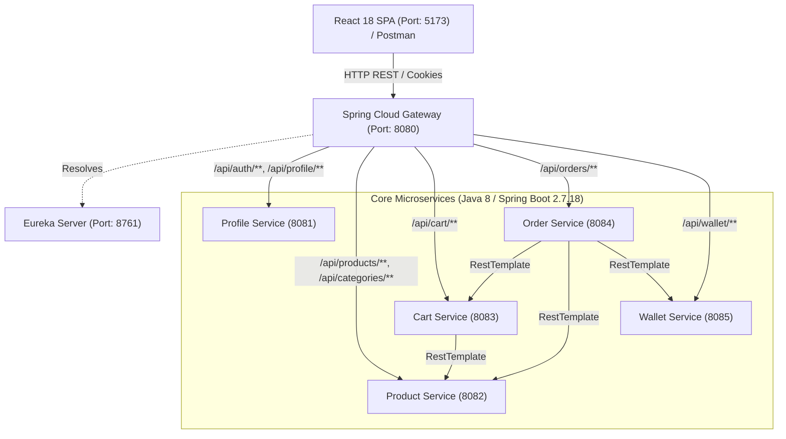

# E-ShoppingZone (E-Cart Management System)

[](https://www.oracle.com/java/)
[](https://spring.io/projects/spring-boot)
[](https://spring.io/projects/spring-cloud)
[](https://react.dev/)
[](https://www.mysql.com/)
[]()
[]()
[]()

An enterprise-grade, distributed e-commerce microservices platform built strictly against the **Capgemini Case Study** specification. E-ShoppingZone provides end-to-end e-commerce capabilities for both **Customers** (product search, cart management, checkout, digital wallet, cash on delivery, order history) and **Merchants** (catalog management, stock adjustment, order monitoring).

---

## 1. Architectural Highlights

- **Strict Framework Baseline**: Pure **Java 8 bytecode** (`major version: 52`), **Spring Boot 2.7.18**, **Spring Cloud 2021.0.9**, and **Hibernate 5.6.x**.
- **Microservices Domain Isolation**: 7 autonomous Spring Boot applications with independent MySQL schemas (`profile_db`, `product_db`, `cart_db`, `order_db`, `wallet_db`).
- **Discovery & Routing**: Service registration with **Netflix Eureka** (`:8761`) and perimeter routing via **Spring Cloud Gateway** (`:8080`).
- **Distributed Checkout Saga**: Orchestrated pre-persistence state machine across Cart, Product (stock reservation), Wallet (payment deduction), and Order with automated compensating rollbacks and crash recovery.
- **Enterprise Security**:
  - Stateless **JWT Access Tokens** (15-min expiry) stored exclusively in React client memory.
  - Opaque cryptographically random **Refresh Tokens** (7-day expiry) stored as SHA-256 hashes in MySQL, delivered via `HttpOnly; SameSite=Lax` cookies.
  - **Refresh Token Rotation (RTR)** with proactive **Replay Attack Detection** (invalidates all sessions if a rotated token is reused).
  - Social authentication via **GitHub OAuth 2.0**.
  - Strict **Anti-CSRF Defense** (`AntiCsrfFilter` requiring `X-Requested-With: XMLHttpRequest` and Origin verification).
  - Strict **Role-Based Access Control (RBAC)** separating `ROLE_CUSTOMER` and `ROLE_MERCHANT`.
  - **Zero-Trust Customer Isolation (Anti-IDOR)** preventing cross-user data exposure.
- **Financial Ledger & Concurrency**:
  - Pessimistic write locking (`@Lock(LockModeType.PESSIMISTIC_WRITE)`) in Digital Wallet eliminating double-spend and race conditions.
  - Immutable transaction ledger recording `balance_before` and `balance_after`.
  - All monetary values handled via `BigDecimal` and MySQL `DECIMAL(12,2)`.
  - Complete request idempotency on payments, deposits, and checkouts.
- **Zero Containerization Dependency**: Runs natively on bare-metal Windows services without Docker or Kubernetes.

---

## 2. Microservice & Port Matrix

| Service / Container | Port | Database Schema | Primary Responsibility | Interactive Swagger UI |
| :--- | :---: | :---: | :--- | :--- |
| **Discovery Server** | `8761` | None | Netflix Eureka Service Registry | [http://localhost:8761](http://localhost:8761) |
| **API Gateway** | `8080` | None | Edge Routing, CORS & Perimeter JWT Auth | N/A (Edge Gateway) |
| **Profile Service** | `8081` | `profile_db` | Auth, Profiles, GitHub OAuth, RTR | [http://localhost:8081/swagger-ui/index.html](http://localhost:8081/swagger-ui/index.html) |
| **Product Service** | `8082` | `product_db` | Catalog, Categories, Stock Reservation | [http://localhost:8082/swagger-ui/index.html](http://localhost:8082/swagger-ui/index.html) |
| **Cart Service** | `8083` | `cart_db` | Customer Cart & Live Price Verification | [http://localhost:8083/swagger-ui/index.html](http://localhost:8083/swagger-ui/index.html) |
| **Order Service** | `8084` | `order_db` | Checkout Saga, History, Snapshots, COD | [http://localhost:8084/swagger-ui/index.html](http://localhost:8084/swagger-ui/index.html) |
| **Wallet Service** | `8085` | `wallet_db` | Digital Ledger, Deductions, Refunds | [http://localhost:8085/swagger-ui/index.html](http://localhost:8085/swagger-ui/index.html) |
| **React Web App** | `5173` | Browser | Customer & Merchant Web Experience | [http://localhost:5173](http://localhost:5173) |

---

## 3. High-Level Architecture Diagram



---

## 4. Quickstart Guide (Local Windows)

### 4.1 Prerequisites
- **Java JDK 8** (or JDK 17 configured for Java 8 compilation)
- **Apache Maven 3.6+**
- **Node.js 18+** & **npm 9+**
- **MySQL Server 8.0+** running locally on port `3306`
- **PowerShell 5.1+**

### 4.2 Initialize Databases & Seed Data
Execute the master SQL script:
```powershell
Get-Content scripts\init-databases.sql | mysql -u root -p
```
*(Creates 5 schemas, all tables, categories, 12 products, inventory, and demo user accounts).*

### 4.3 Automated One-Command Startup
```powershell
.\start-all-services.ps1
```
*The script checks MySQL, starts all 7 microservices in sequence, verifies health checks, and starts the React frontend.*

### 4.4 Automated One-Command Shutdown
```powershell
.\stop-all-services.ps1
```
*Gracefully terminates all tracked service PIDs and sweeps ports `8761`, `8080-8085`, and `5173`.*

---

## 5. Pre-Configured Demo Accounts

| Role | Email Address | Password | Initial State / Purpose |
| :--- | :--- | :--- | :--- |
| **Customer** | `customer@eshopping.com` | `Pass1234!` | Pre-funded with **₹100,000.00**; ready for shopping & checkout. |
| **Merchant** | `merchant@eshopping.com` | `Pass1234!` | Owner of 28 catalog products across 4 categories. |
| **Poor Customer** | `poor@eshopping.com` | `Pass1234!` | **₹0.00** wallet balance; used to demonstrate Saga payment failure rollback. |

---

## 6. Verification & Test Execution

### 6.1 Backend Reactor Tests (120 Tests)
```powershell
cd backend && mvn test
```
*Result: 120 tests passing, 0 failures, 0 skipped.*

### 6.2 Frontend Unit & Component Tests (20 Tests)
```powershell
cd frontend && npm test
```
*Result: 20 tests passing, 0 failures.*

### 6.3 Full-System End-to-End Verification
```powershell
.\verify-full-system-e2e.ps1
```
*Result: 8/8 phases passing (Infrastructure, Auth, Catalog, Cart, Wallet, Saga Checkout, Cancellation Compensation, COD & IDOR).*

---

## 7. Master Documentation Index

| Documentation Guide | Scope & Contents |
| :--- | :--- |
| **[Master Startup & Swagger Guide](STARTUP_GUIDE.md)** | Step-by-step instructions to start/stop DB, backend services, frontend, and access all Swagger UIs. |
| **[System Requirements (SRS)](REQUIREMENTS.md)** | Full Capgemini Case Study specification breakdown, functional & non-functional matrices, use cases, and flowcharts. |
| **[System Architecture](ARCHITECTURE.md)** | C4 diagrams, Distributed Saga orchestration, crash recovery, concurrency locking, and failover tuning. |
| **[Database Specification](DATABASE.md)** | Schemas for 5 databases, complete data dictionaries, ER relationships, index strategy, and backup/restore. |
| **[API Documentation](API_DOCUMENTATION.md)** | Complete REST catalog, request/response bodies, HTTP methods, headers, and Swagger UI links. |
| **[Local Setup & Operations](SETUP_GUIDE.md)** | Step-by-step local Windows installation, configuration, startup, shutdown, and troubleshooting. |
| **[Testing & Quality Assurance](TESTING_GUIDE.md)** | Multi-tier test strategy, 120-test Surefire audit, concurrency test mechanics, and E2E verification. |
| **[Security Architecture](SECURITY.md)** | JWT lifecycles, Refresh Token Rotation (RTR), Anti-CSRF filter, Anti-IDOR customer isolation, and RBAC. |
| **[Project Status Matrix](PROJECT_STATUS.md)** | Phase-by-phase completion status (100%) and 37-point traceable acceptance criteria checklist. |
| **[Changelog](CHANGELOG.md)** | Complete version history from Phase 1 through Phase 10 delivery. |
