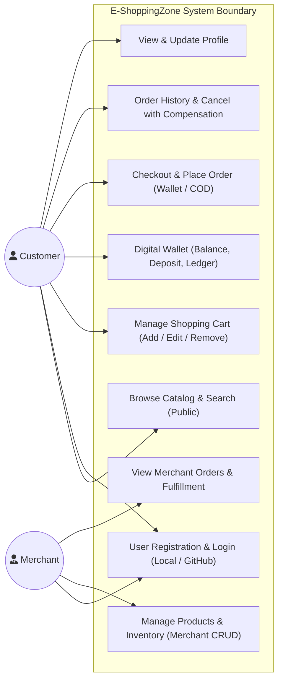
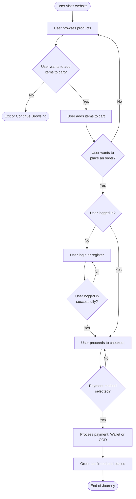

# E-ShoppingZone System Requirements Specification (SRS)

This specification documents the complete business, functional, architectural, security, and non-functional requirements for the **E-ShoppingZone (E-Cart Management System)** microservices platform, derived directly from the official **Capgemini Case Study** specification (`E-ShoppingZone.pdf`) and subsequent architectural blueprints.

---

## 1. Problem Statement & System Scope

### 1.1 Business Context
E-ShoppingZone is an enterprise e-commerce platform facilitating online buying and selling of consumer goods across multiple product categories (Electronics, Books & Media, Fashion & Apparel, Home & Kitchen, Personal Care).

The system serves two distinct user personas with segregated capabilities:
1. **Customer (Shopper)**: Can browse the catalog, search for products without logging in, manage a persistent shopping cart, authenticate securely (via email/password or GitHub OAuth 2.0), execute checkout with automated stock reservation, choose between Digital Wallet and Cash on Delivery (COD), review immutable order histories, and manage their personal profile.
2. **Merchant (Seller)**: Can register via controlled administrative invite codes, manage products in their catalog (create, edit details, update stock, delete/deactivate) with strict ownership isolation (anti-IDOR), and monitor fulfillment for orders containing their products.

---

## 2. Actors & Use Case Modeling

### 2.1 Customer Use Cases

| Use Case ID | Name | Preconditions | Main Flow | Postconditions |
| :--- | :--- | :--- | :--- | :--- |
| **UC-C01** | Browse & Search Catalog | None (Public access) | User filters by category, price range, or enters keyword search. | Paginated product list returned with real-time stock and prices. |
| **UC-C02** | Customer Registration | Unauthenticated | User submits name, email, password, phone. System assigns `ROLE_CUSTOMER`. | User record created with BCrypt password hash in `profile_db`. |
| **UC-C03** | Customer Authentication | Registered user | User logs in via email/password or GitHub OAuth. | 15-min JWT access token issued to client memory; 7-day refresh token set in `HttpOnly` cookie. |
| **UC-C04** | Manage Shopping Cart | Authenticated Customer | User adds item, increments/decrements quantity, or removes item. | Cart Service dynamically checks live prices with Product Service and updates `cart_db`. |
| **UC-C05** | Digital Wallet Operations | Authenticated Customer | User views balance, transaction history, or simulates a balance deposit. | Wallet balance updated atomically; immutable ledger record created with before/after balances. |
| **UC-C06** | Checkout & Order Placement | Authenticated Customer with active cart | User selects payment mode (Wallet / COD) and provides shipping address. | Distributed Saga executes: reserves stock, debits wallet (if wallet payment), creates immutable order, clears cart. |
| **UC-C07** | Cancel Order | Authenticated Customer (Owner of Order) | User requests cancellation on placed order. | Saga rollback triggered: wallet refunded, stock released back to inventory, order marked `CANCELLED`. |

### 2.2 Merchant Use Cases

| Use Case ID | Name | Preconditions | Main Flow | Postconditions |
| :--- | :--- | :--- | :--- | :--- |
| **UC-M01** | Merchant Onboarding | Valid Invite Code | Merchant submits registration with `ESHOPPING_MERCHANT_INVITE_2026`. | User created and granted `ROLE_MERCHANT`. |
| **UC-M02** | Product Catalog Management | Authenticated Merchant | Merchant creates, updates price/stock, or removes a product. | Anti-IDOR ownership validated; product and inventory updated in `product_db`. |
| **UC-M03** | Monitor Merchant Orders | Authenticated Merchant | Merchant accesses `/api/orders/merchant`. | Displays orders containing products owned strictly by this merchant. |

---

## 3. End-to-End User Journey Activity Flow

The following flow represents the core shopping workflow specified on **Page 2** of the Capgemini Case Study document:

---

## 4. Traceable Functional Requirements (FR) Matrix

Every requirement extracted from `E-ShoppingZone.pdf` is mapped directly to its architectural tier, microservice, implementation class, and verification evidence:

| Req ID | Requirement Statement (from Capgemini Specification) | Target Microservice | Primary Implementation | Status |
| :--- | :--- | :---: | :--- | :---: |
| **FR-01** | User can search for a product without login and access the website. | `product-service` | `ProductController.searchProducts()` & `getProducts()` | [x] Fulfilled |
| **FR-02** | User can login with GitHub or with registered account. | `profile-service` | `OAuth2AuthenticationSuccessHandler` & `AuthController.login()` | [x] Fulfilled |
| **FR-03** | User can add or remove products from the cart. | `cart-service` | `CartController.addItem()`, `updateQuantity()`, `removeItem()` | [x] Fulfilled |
| **FR-04** | For placing an order, user must log in or create an active account. | `api-gateway` & `order-service` | `JwtAuthFilter` & `OrderController.checkout()` | [x] Fulfilled |
| **FR-05** | User can update profile whenever needed. | `profile-service` | `ProfileController.getProfile()` & `updateProfile()` | [x] Fulfilled |
| **FR-06** | User can make wallet payment and cash on delivery (COD). | `order-service` & `wallet-service` | `PaymentMethod.WALLET`, `PaymentMethod.COD` | [x] Fulfilled |
| **FR-07** | User can view previous orders and transactions. | `order-service` & `wallet-service` | `OrderController.getOrders()`, `WalletController.getTransactions()` | [x] Fulfilled |
| **FR-08** | Products displayed category-wise (electronics, books, apparel, personal care). | `product-service` | `CategoryController.getCategories()` & `Category` entity | [x] Fulfilled |
| **FR-09** | Cart total displayed accurately on checkout page. | `cart-service` | `CartServiceImpl.calculateTotal()` using `BigDecimal` | [x] Fulfilled |
| **FR-10** | Merchant role sells products and manages catalog. | `product-service` | `ProductController.createProduct()`, `updateProduct()`, `deleteProduct()` | [x] Fulfilled |
| **FR-11** | Inter-service HTTP communication using Rest Template. | All Services | `@LoadBalanced RestTemplate` across Cart, Product, Wallet, Order | [x] Fulfilled |
| **FR-12** | Database integration using MySQL for all entities. | All Services | 5 independent schemas (`profile_db`, `product_db`, etc.) | [x] Fulfilled |
| **FR-13** | Frontend developed with React and RESTful APIs. | `frontend` | React 18 SPA (TypeScript + Vite) communicating with Gateway | [x] Fulfilled |
| **FR-14** | Eureka Server for service registration and discovery. | `discovery-server` | Spring Cloud Netflix Eureka Server on Port `8761` | [x] Fulfilled |
| **FR-15** | Gateway Service for routing, load balancing, and perimeter security. | `api-gateway` | Spring Cloud Gateway on Port `8080` | [x] Fulfilled |

---

## 5. Architectural & Technical Requirements (TR)

| Req ID | Requirement | Architectural Enforcement |
| :--- | :--- | :--- |
| **TR-01** | **Strict Java 8 Baseline** | Compiled with `source: 1.8` and `target: 1.8`. Verified via `javap -v` to output `major version: 52` across all compiled `.class` files. |
| **TR-02** | **Framework Compatibility** | Spring Boot `2.7.18`, Spring Cloud `2021.0.9`, Spring Security `5.7.12`, Spring Data JPA `2.7.18`. |
| **TR-03** | **Zero Containerization** | Local execution must run bare-metal on Microsoft Windows without Docker, Docker Compose, or Kubernetes. |
| **TR-04** | **Database-Per-Service** | 5 discrete MySQL schemas (`profile_db`, `product_db`, `cart_db`, `order_db`, `wallet_db`). Cross-database SQL joins are strictly prohibited. |
| **TR-05** | **Distributed Saga Orchestration** | Pre-persistence state machine orchestrates checkout across Cart, Product (stock reserve), and Wallet (payment deduction). |
| **TR-06** | **Compensating Rollbacks** | If wallet payment fails, reserved product stock is restored. If a placed order is cancelled, stock is restored and wallet is refunded. |
| **TR-07** | **Process Crash Reconciliation** | `reconcilePendingSagas()` resolves stuck intermediate states (`STOCK_RESERVED`, `COMPENSATING_STOCK`, `COMPENSATING_PAYMENT`) into terminal consistency. |
| **TR-08** | **High Concurrency Stock Integrity** | Product inventory uses Hibernate `@Version` optimistic locking to prevent stock overselling under flash sales. |
| **TR-09** | **Financial Balance Concurrency** | Digital Wallet uses `@Lock(LockModeType.PESSIMISTIC_WRITE)` (`SELECT ... FOR UPDATE`) during balance deductions, completely preventing race conditions. |
| **TR-10** | **Financial Arithmetic Accuracy** | All monetary calculations use `java.math.BigDecimal` mapped to MySQL `DECIMAL(12,2)`. Float or double types are strictly disallowed. |
| **TR-11** | **Discovery Failover Optimization** | Configured with `registry-fetch-interval-seconds: 5` and `spring.cloud.loadbalancer.cache.ttl: 3s` for fast 5-second dynamic recovery. |
| **TR-12** | **Interactive API Documentation** | Every backend service exposes Springdoc OpenAPI 1.8.x Swagger UI on its respective port (`/swagger-ui/index.html`). |

---

## 6. Security & Non-Functional Requirements (NFR)

| Req ID | Category | Requirement & Defense Strategy |
| :--- | :--- | :--- |
| **NFR-01** | **Token Lifetime & Storage** | Stateless JWT access tokens (15-min TTL) stored exclusively in JavaScript memory (`AuthContext`). Never written to `localStorage`. |
| **NFR-02** | **Refresh Token Rotation (RTR)** | Cryptographically random opaque tokens (7-day TTL) stored as SHA-256 hashes in MySQL. Delivered via `HttpOnly; SameSite=Lax` cookies. |
| **NFR-03** | **Replay Attack Detection** | Reusing an already revoked refresh token triggers immediate lineage revocation of all active sessions for that user. |
| **NFR-04** | **Anti-CSRF Defense** | `AntiCsrfFilter` requires custom header `X-Requested-With: XMLHttpRequest` and Origin whitelisting for all cookie-based endpoints. |
| **NFR-05** | **Role Separation (RBAC)** | Customer registration strictly grants `ROLE_CUSTOMER`. Merchant registration requires administrative code (`ESHOPPING_MERCHANT_INVITE_2026`). |
| **NFR-06** | **Anti-IDOR Customer Isolation** | Customer endpoints extract `userId` strictly from verified JWT claims (`@AuthenticationPrincipal`). Cross-customer order lookups return `404 Not Found`. |
| **NFR-07** | **Merchant Ownership Defense** | Merchants can only view, update, or delete products and order items they own. |
| **NFR-08** | **Internal Saga Security** | Internal endpoints (`/api/products/reserve`, `/api/products/release`, `/api/wallet/pay`, `/api/wallet/refund`, `/api/orders/reconcile`) require `X-Internal-Secret`. |
| **NFR-09** | **Request Idempotency** | Payments, refunds, and deposits enforce unique `idempotencyKey` values to prevent duplicate financial processing. |
| **NFR-10** | **Password Hashing** | Passwords hashed using BCrypt with strength cost factor 10 (`BCryptPasswordEncoder(10)`). |

---

## 7. Cross-Laptop Portability Requirements

To execute this platform on any other Windows workstation, the target system must satisfy:

1. **Runtimes Installed in System PATH**:
   - Java JDK 8 or 17 (`java -version`).
   - Apache Maven 3.6+ (`mvn -v`).
   - Node.js 18+ or 20+ (`node -v`).
   - MySQL Server 8.x on port `3306` (`mysql --version`).
2. **Database Provisioning**:
   - Run `Get-Content scripts\init-databases.sql | mysql -u root -p`.
3. **Compilation (if clean clone)**:
   - Run `cd backend && mvn clean package -DskipTests && cd ..`.
   - Run `cd frontend && npm install && npm run build && cd ..`.
4. **Execution**:
   - Run `.\start-all-services.ps1` to start.
   - Run `.\stop-all-services.ps1` to stop.

