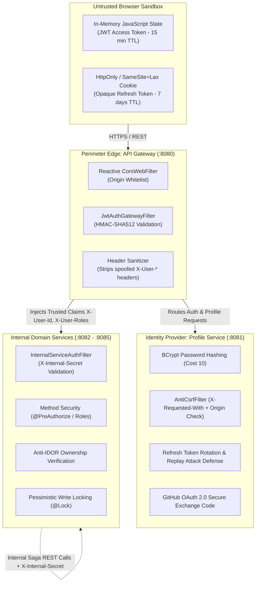
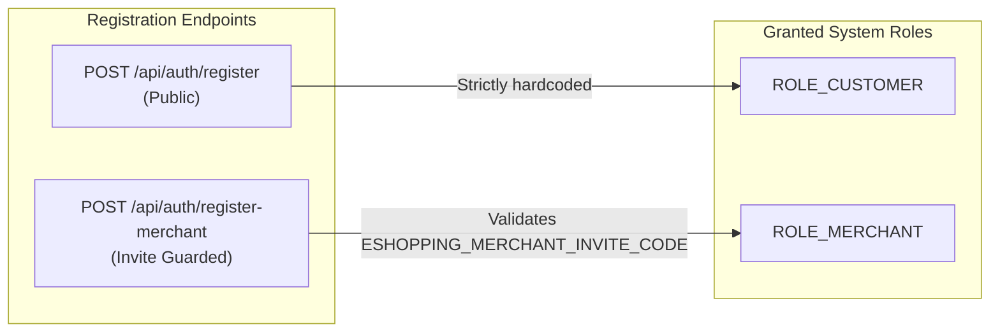

# E-ShoppingZone Security Architecture & Threat Defense Specification

[](https://www.oracle.com/java/)
[](https://spring.io/projects/spring-security)
[](https://jwt.io/)
[](https://owasp.org/www-project-application-security-verification-standard/)

This document outlines the multi-layered security architecture, token lifecycles, cryptographic standards, anti-CSRF protections, and authorization models implemented across the **E-ShoppingZone** microservices platform.

---

## 1. Security Architecture Overview

The platform enforces a **Defense-in-Depth** and **Zero-Trust** security posture across all tiers:



---

## 2. Authentication & Token Lifecycle

### 2.1 Dual-Token Pattern
To eliminate the risk of long-lived compromised credentials while avoiding poor user experience from frequent re-logins, the system implements a dual-token architecture:

| Token Characteristic | Access Token | Refresh Token |
| :--- | :--- | :--- |
| **Token Type** | Stateless JSON Web Token (JWT) | Opaque cryptographically random hex string |
| **Signing Algorithm** | HMAC-SHA512 (`HS512`, 512-bit key) | N/A (Cryptographic randomness via `SecureRandom`) |
| **Lifespan** | **15 minutes** (900,000 ms) | **7 days** (604,800 seconds) |
| **Client Storage** | React Application Memory (`AuthContext`) | `HttpOnly; SameSite=Lax; Path=/api/auth` Cookie |
| **Database Storage** | Stateless (Not stored in database) | **SHA-256 Hash** stored in MySQL `refresh_tokens` |
| **Exposure Risk** | Never touches `localStorage` / `sessionStorage` | JavaScript cannot read or extract via XSS |

---

### 2.2 Refresh Token Rotation (RTR) & Replay Attack Defense
Every token refresh request rotates the token pair and evaluates lineage for replay attacks.

```mermaid
sequenceDiagram
    autonumber
    actor Client as Legitimate Client
    actor Attacker as Malicious Actor (Stolen Token T1)
    participant Auth as Profile Service (RefreshTokenService)
    participant DB as profile_db (refresh_tokens)

    Client->>Auth: POST /api/auth/refresh (Presents T1)
    Auth->>DB: Check T1 status (Active, not revoked)
    Auth->>DB: Update T1: revoked = TRUE, rotatedAt = NOW()
    Auth->>DB: Insert T2: active, parent_hash = SHA256(T1)
    Auth-->>Client: 200 OK + New Access Token + Set-Cookie(T2)

    note over Attacker,Auth: Attacker attempts to replay stolen T1
    Attacker->>Auth: POST /api/auth/refresh (Presents T1)
    Auth->>DB: Check T1 status (Found: revoked == TRUE!)
    
    rect rgb(255, 230, 230)
        note over Auth,DB: REPLAY ATTACK DETECTED!
        Auth->>DB: UPDATE refresh_tokens SET revoked = TRUE WHERE user_id = :userId
        Auth-->>Attacker: 401 Unauthorized (Security Alert: Replay Detected)
    end
    
    note over Client,Auth: Legitimate client tries to refresh with T2
    Client->>Auth: POST /api/auth/refresh (Presents T2)
    Auth-->>Client: 401 Unauthorized (Session invalidated; user forced to re-login)
```

1. **Storage Security**: Only `SHA-256(token)` is stored in `refresh_tokens.token_hash`. A compromised database dump cannot be used to impersonate sessions.
2. **Deterministic Revocation**: When `revoked == TRUE` is encountered during refresh, `revokeAllUserTokens(userId)` is immediately triggered.

---

## 3. Cross-Site Request Forgery (Anti-CSRF) Defense

Because refresh tokens are delivered via browser cookies, the platform implements strict multi-layer CSRF defenses in `AntiCsrfFilter`:

### 3.1 Custom Header Enforcement (`X-Requested-With`)
- All cookie-bearing endpoints (`/api/auth/refresh`, `/api/auth/logout`, `/api/auth/logout-all`) require the presence and exact value of:
  ```http
  X-Requested-With: XMLHttpRequest
  ```
- **Browser Security Invariant**: The W3C Fetch / XMLHttpRequest specifications prevent cross-origin websites (`attacker.com`) from setting custom HTTP headers without explicit server consent via a preflight `OPTIONS` request (`Access-Control-Allow-Headers: X-Requested-With`). Because `api-gateway` does not whitelist arbitrary origins, cross-origin scripts cannot forge this request.

### 3.2 Origin Header Whitelisting
- `AntiCsrfFilter` inspects the HTTP `Origin` header.
- Requests originating from domains other than the whitelisted origins (`http://localhost:5173` and `http://localhost:8080`) are immediately rejected with `403 Forbidden`.

### 3.3 Cookie Flags
Refresh cookies are issued with protective directives:
- `HttpOnly`: Strictly prevents client-side JavaScript access via `document.cookie`, mitigating XSS exfiltration.
- `SameSite=Lax`: Directs modern browsers not to attach the cookie to cross-site `POST` requests.
- `Path=/api/auth`: Restricts the scope of cookie transmission exclusively to the authentication endpoints.

### 3.4 Secure One-Time OAuth2 Exchange Code Pattern
To prevent access token leakage into browser history, proxy access logs, and HTTP Referer headers during social login redirects:
1. **Zero Tokens in URLs**: `OAuth2AuthenticationSuccessHandler` never attaches JWT access tokens or refresh cookies to redirect URLs.
2. **Ephemeral One-Time Exchange Code**:
   - The backend generates a cryptographically random, 256-bit hexadecimal code stored in `OAuth2ExchangeCodeStore`.
   - The code has a strict **60-second time-to-live (TTL)**.
   - The user is redirected to the frontend callback:
     ```http
     GET http://localhost:5173/oauth2/redirect?code=d3a9f1b8...
     ```
3. **Atomic Single-Use Redemption**:
   - The React frontend immediately issues a POST request:
     ```http
     POST /api/auth/oauth2/exchange
     Content-Type: application/json
     
     { "code": "d3a9f1b8..." }
     ```
   - The code is atomically consumed and purged from memory (`exchangeCodeStore.consumeCode(code)`). Any replay attempt is rejected with `401 Invalid or expired OAuth2 exchange code`.
   - The response payload delivers the user profile and in-memory access token, and sets the secure `HttpOnly` refresh cookie.
4. **Origin & Cookie Alignment**: The OAuth authorization initiation and callback endpoints are matched to the same origin (`http://localhost:8080` or direct service) to avoid browser cross-origin cookie rejection boundaries.

---

## 4. Controlled Merchant Onboarding & Role Separation

The platform enforces strict separation between shoppers (`ROLE_CUSTOMER`) and sellers (`ROLE_MERCHANT`):



1. **Anti-Escalation**: The customer registration endpoint ignores any role requests in the payload and exclusively grants `ROLE_CUSTOMER`.
2. **Administrative Secret**: Merchant registration requires matching `ESHOPPING_MERCHANT_INVITE_CODE` (`ESHOPPING_MERCHANT_INVITE_2026`). Invalid or missing codes result in `403 Forbidden`.

---

## 5. Zero-Trust Customer Isolation (Anti-IDOR)

Insecure Direct Object Reference (IDOR) vulnerabilities allow attackers to view or modify other users' data simply by altering numeric resource identifiers (e.g., `GET /api/orders/42`).

### 5.1 IDOR Elimination Strategy
1. **No Frontend Customer IDs**: Endpoints such as `GET /api/cart`, `POST /api/cart/items`, `GET /api/wallet`, and `POST /api/orders/checkout` do not accept customer IDs.
2. **Gateway Extraction**: The Gateway validates the JWT, strips any incoming client headers matching `X-User-*` to prevent header injection spoofing, and sets trusted `X-User-Id` downstream.
3. **Controller Ownership Assertion**:
   ```java
   // In OrderController:
   @GetMapping("/{id}")
   public ResponseEntity<OrderDTO> getOrderById(@PathVariable Long id, @AuthenticationPrincipal Long userId) {
       OrderDTO order = orderService.getOrderByIdAndCustomerId(id, userId);
       return ResponseEntity.ok(order);
   }
   ```
4. **404 Masking**: If Customer A queries an order owned by Customer B, the query returns empty and the service responds with `404 Not Found` (rather than `403 Forbidden`), completely hiding whether that order ID even exists.

---

## 6. Internal Service-to-Service Defense (Saga Security)

Internal Saga coordination endpoints must never be directly accessible to end-users:

| Protected Internal Endpoint | Microservice | Purpose |
| :--- | :---: | :--- |
| `POST /api/products/reserve` | Product Service | Decrements available stock during Saga Step A |
| `POST /api/products/release` | Product Service | Restores reserved stock during Saga compensation |
| `POST /api/wallet/pay` | Wallet Service | Deducts balance during Saga Step B |
| `POST /api/wallet/refund` | Wallet Service | Refunds balance during Saga compensation |
| `POST /api/orders/reconcile` | Order Service | Reconciles intermediate stuck Sagas |

### 6.1 `InternalServiceAuthFilter`
- Every internal endpoint is intercepted by `InternalServiceAuthFilter`.
- Requires the presence of header:
  ```http
  X-Internal-Secret: ESHOPPING_INTERNAL_SERVICE_SECRET_2026
  ```
- If the header is missing or does not match the configured secret, the request is rejected with `401 Unauthorized`.
- The Gateway is configured to strip or block external access to these internal routes.

---

## 7. Financial Ledger & Concurrency Defense

To guarantee financial integrity in the Digital Wallet:

1. **Pessimistic Write Locking**:
   All balance modifications acquire an exclusive lock:
   ```sql
   SELECT * FROM wallets WHERE user_id = ? FOR UPDATE;
   ```
   Concurrent payment requests against the same wallet are queued linearly by the database engine, completely eliminating double-spend race conditions.
2. **Immutable Ledger**:
   Balance updates and transaction creation are executed in a single atomic database transaction. Every row in `wallet_transactions` records `balance_before` and `balance_after`.
3. **Idempotency Key Enforcement**:
   Every payment and deposit request requires an `idempotencyKey`. Duplicate keys return the existing transaction record without mutating wallet funds twice.

