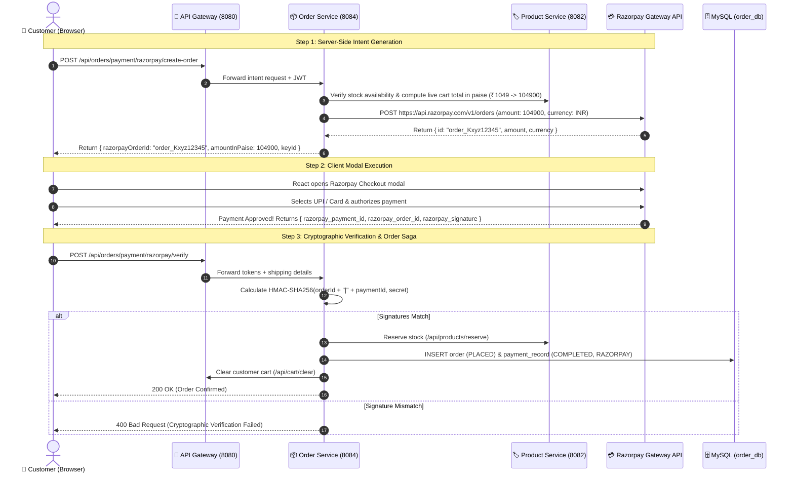

# E-ShoppingZone Payment Gateway Integration Guide

This document details the architectural design, database schemas, cryptographic verification algorithms, API contracts, and testing procedures for the **Razorpay Payment Gateway** integrated into the **E-ShoppingZone** microservices platform.

---

## 1. Executive Summary & Architectural Overview

In **E-ShoppingZone**, the payment infrastructure is designed to support multi-channel checkout:
1. **E-Shopping Wallet**: Internal high-speed digital ledger with `@Lock(LockModeType.PESSIMISTIC_WRITE)`.
2. **Razorpay Gateway**: External payment aggregator supporting **UPI** (Google Pay, PhonePe, Paytm), **Credit/Debit Cards** (Visa, MasterCard, RuPay), and **NetBanking**.
3. **Cash on Delivery (COD)**: Post-delivery fulfillment settlement.

### High-Level Topology

```
+-----------------------------------------------------------------------------------+
|                                React 18 Web UI                                    |
|   (Loads Razorpay Checkout.js, presents UPI/Card options, captures signatures)    |
+----------------------------------------+------------------------------------------+
                                         |
                                (HTTP /api/orders/*)
                                         v
+-----------------------------------------------------------------------------------+
|                           Spring Cloud API Gateway (8080)                         |
|            (CORS Headers, JWT Token Relay, Service Discovery Routing)             |
+----------------------------------------+------------------------------------------+
                                         |
                               (Forwarded to Order Service)
                                         v
+-----------------------------------------------------------------------------------+
|                               Order Service (8084)                                |
|  - Phase 1: POST /api/orders/payment/razorpay/create-order (Creates Order Intent) |
|  - Phase 2: POST /api/orders/payment/razorpay/verify (HMAC-SHA256 Verification)   |
|  - Phase 3: POST /api/orders/{id}/cancel (Automated Gateway Refund)               |
+-------------------+--------------------+--------------------+---------------------+
                    |                    |                    |
         (Stock Check/Reserve)     (Clear Cart)       (Save Records)
                    v                    v                    v
          +------------------+ +------------------+ +------------------+
          | Product Service  | |   Cart Service   | | MySQL (order_db) |
          |      (8082)      | |      (8083)      | | (payment_records)|
          +------------------+ +------------------+ +------------------+
```

---

## 2. End-to-End Sequence Diagram



---

## 3. Database Schema Modifications

The `payment_records` table in `order_db` stores gateway tokens for auditing and reconciliation:

```sql
ALTER TABLE order_db.payment_records 
  ADD COLUMN gateway_order_id VARCHAR(100) NULL,
  ADD COLUMN gateway_payment_id VARCHAR(100) NULL,
  ADD COLUMN gateway_signature VARCHAR(255) NULL;
```

### Table Structure (`order_db.payment_records`):

| Column | Type | Description |
| :--- | :--- | :--- |
| `id` | `BIGINT AUTO_INCREMENT` | Primary Key. |
| `order_id` | `BIGINT` | Foreign Key to `orders(id)`. |
| `payment_reference` | `VARCHAR(64)` | Unique transaction reference (`pay_...`). |
| `payment_method` | `VARCHAR(30)` | Enum: `WALLET`, `CASH_ON_DELIVERY`, `RAZORPAY`. |
| `amount` | `DECIMAL(12,2)` | Amount charged in Rupees. |
| `status` | `VARCHAR(30)` | `COMPLETED`, `REFUNDED`, `FAILED`. |
| `gateway_order_id` | `VARCHAR(100)` | Razorpay Order ID (`order_...`). |
| `gateway_payment_id` | `VARCHAR(100)` | Razorpay Payment ID (`pay_...`). |
| `gateway_signature` | `VARCHAR(255)` | Cryptographic HMAC-SHA256 signature received from gateway. |
| `gateway_response` | `TEXT` | Audit notes & verification metadata. |
| `created_at` | `TIMESTAMP` | Record timestamp. |

---

## 4. Cryptographic Signature Verification (Anti-Tampering)

To guarantee that payment confirmations cannot be spoofed by modifying client JavaScript, the backend verifies an **HMAC-SHA256 hash** using the secret key known only to the backend and Razorpay:

### Formula:
$$\text{payload} = \text{razorpay\_order\_id} + "|" + \text{razorpay\_payment\_id}$$
$$\text{expected\_signature} = \text{HexEncode}(\text{HMAC-SHA256}(\text{payload}, \text{KEY\_SECRET}))$$

### Implementation in `RazorpayServiceImpl.java`:
```java
String payload = orderId + "|" + paymentId;
Mac mac = Mac.getInstance("HmacSHA256");
SecretKeySpec secretKeySpec = new SecretKeySpec(keySecret.getBytes(StandardCharsets.UTF_8), "HmacSHA256");
mac.init(secretKeySpec);
byte[] hash = mac.doFinal(payload.getBytes(StandardCharsets.UTF_8));

StringBuilder hexString = new StringBuilder();
for (byte b : hash) {
    String hex = Integer.toHexString(0xff & b);
    if (hex.length() == 1) hexString.append('0');
    hexString.append(hex);
}

boolean isVerified = hexString.toString().equalsIgnoreCase(signature.trim());
```

---

## 5. API Endpoints Specification

### 1. Create Razorpay Order Intent
* **Endpoint**: `POST /api/orders/payment/razorpay/create-order`
* **Security**: Bearer JWT (`ROLE_CUSTOMER`)
* **Request Body**:
  ```json
  {
    "shippingName": "Alice Customer",
    "shippingPhone": "9876543210",
    "shippingAddress": "1st Floor, Tech Park, Bangalore - 560100",
    "idempotencyKey": "ORD-179506-xyz"
  }
  ```
* **Response (200 OK)**:
  ```json
  {
    "success": true,
    "message": "Razorpay order intent created successfully",
    "data": {
      "razorpayOrderId": "order_sim_8f2b3e4a91c012",
      "orderNumber": "ORD-7D284AB910EF",
      "amount": 1049.00,
      "amountInPaise": 104900,
      "currency": "INR",
      "keyId": "rzp_test_5yq4Y3m9x12AbC"
    }
  }
  ```

---

### 2. Verify Payment Signature & Place Order
* **Endpoint**: `POST /api/orders/payment/razorpay/verify`
* **Security**: Bearer JWT (`ROLE_CUSTOMER`)
* **Request Body**:
  ```json
  {
    "razorpayOrderId": "order_sim_8f2b3e4a91c012",
    "razorpayPaymentId": "pay_sim_1795064000",
    "razorpaySignature": "mock_valid_signature",
    "orderNumber": "ORD-7D284AB910EF",
    "shippingName": "Alice Customer",
    "shippingPhone": "9876543210",
    "shippingAddress": "1st Floor, Tech Park, Bangalore - 560100",
    "idempotencyKey": "ORD-179506-xyz"
  }
  ```
* **Response (200 OK)**:
  ```json
  {
    "success": true,
    "message": "Payment verified and order placed successfully",
    "data": {
      "id": 7,
      "orderNumber": "ORD-7D284AB910EF",
      "orderStatus": "PLACED",
      "totalAmount": 1049.00,
      "payment": {
        "paymentMethod": "RAZORPAY",
        "paymentStatus": "PAID",
        "paymentReference": "pay_sim_1795064000",
        "gatewayOrderId": "order_sim_8f2b3e4a91c012",
        "gatewayPaymentId": "pay_sim_1795064000"
      }
    }
  }
  ```

---

### 3. Automated Refund (Cancellations & Admin Disputes)
* **Triggered by**:
  * Customer clicks **Cancel Order** (`POST /api/orders/{id}/cancel`)
  * Admin resolves dispute with **REFUND** (`POST /api/admin/disputes/{id}/resolve`)
* **Underlying Gateway Call**:
  ```http
  POST https://api.razorpay.com/v1/payments/{paymentId}/refund
  Authorization: Basic [BASE64(KEY_ID:KEY_SECRET)]
  {
    "amount": 104900,
    "notes": {
      "reason": "Admin dispute refund: Product Damaged in Transit"
    }
  }
  ```
* **Database Action**:
  Inserts a refund record with prefix `REF-RZP-...` and transitions order status to `REFUNDED` or `REFUNDED_BY_ADMIN`.

---

## 6. Testing & Sandbox Verification Guide

### Test Credentials:
* **Razorpay Key ID**: `rzp_test_5yq4Y3m9x12AbC`
* **Test Cards**:
  * **Card Number**: `4111 1111 1111 1111`
  * **Expiry**: Any future date (e.g., `12/28`)
  * **CVV**: `123`
  * **OTP**: Any 4- or 6-digit number (e.g., `1234`)
* **Test UPI ID**:
  * `success@razorpay` (Simulates instant UPI approval)
  * `failure@razorpay` (Simulates bank decline)

### How to Test in the Application:
1. Log in as Customer (**`alice@eshopping.com`** / **`Password123!`**).
2. Add any item to your cart and proceed to [Checkout](http://localhost:5173/checkout).
3. Select **Razorpay** from the Payment Methods (alongside Wallet and COD).
4. Fill in the delivery address and click **Place Order**.
5. The Razorpay modal opens:
   * Choose **UPI** and enter `success@razorpay`, or choose **Card** and enter `4111 1111 1111 1111`.
6. Click **Pay**. The system verifies the cryptographic signature on the backend, commits the order, clears your cart, and displays the **Order Details Page** showing the **Razorpay Payment ID**.
