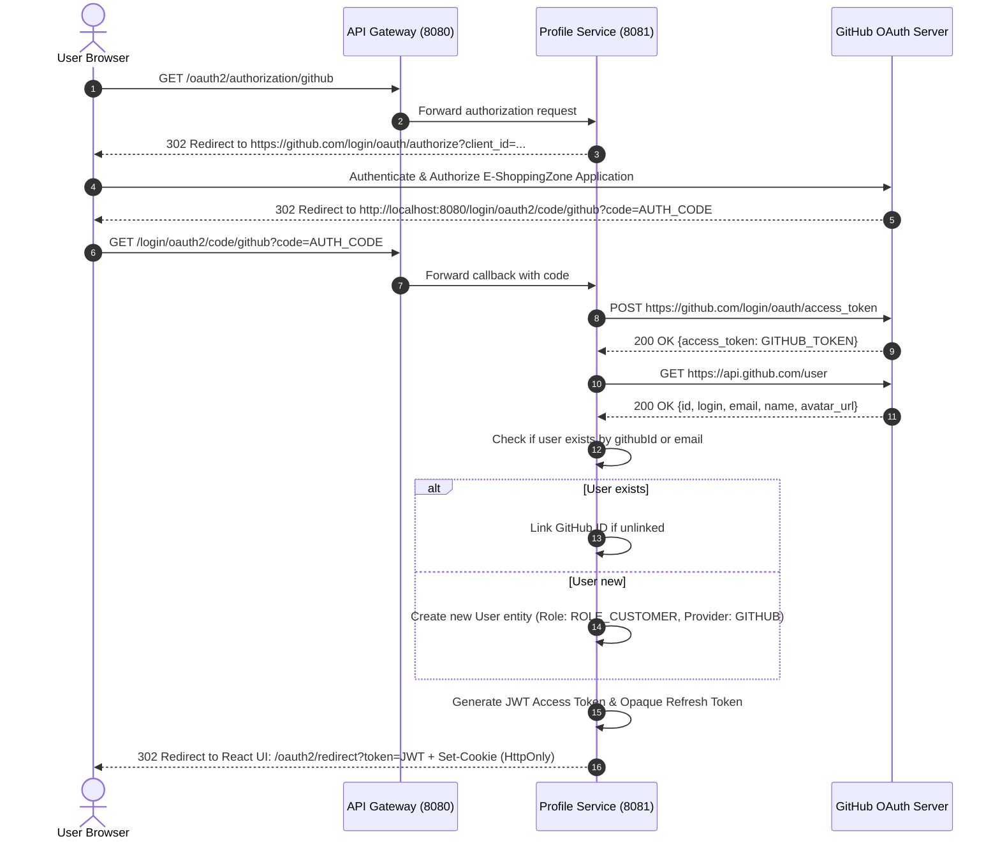

# Authentication & Token Lifecycle Flow

## 1. Authentication Architectural Model

The E-ShoppingZone security architecture combines **stateless JWT Access Tokens** with **secure opaque Refresh Tokens** adhering to the Refresh Token Rotation (RTR) specification. This design satisfies three security imperatives:
1. **Zero Session State on Microservices**: Services validate incoming JWT signatures offline without database hits.
2. **Protection Against XSS Token Theft**: Refresh tokens are stored exclusively in `HttpOnly`, `SameSite=Lax`, `Secure` cookies, which JavaScript running in the browser cannot read. Access tokens are kept in React memory only.
3. **Automatic Replay Attack Detection**: If an adversary intercepts and attempts to replay a previously rotated refresh token, the system detects a token reuse violation and invalidates all active sessions for that user.

---

## 2. Authentication Workflow Sequence

```mermaid
sequenceDiagram
    autonumber
    actor User as User / Browser
    participant Gateway as API Gateway (8080)
    participant Profile as Profile Service (8081)
    participant DB as profile_db (MySQL)

    Note over User, DB: Step 1: Login & Token Issuance
    User->>Gateway: POST /api/auth/login {email, password}
    Gateway->>Profile: Forward to Profile Service
    Profile->>DB: Find user by email
    DB-->>Profile: User entity with BCrypt password hash
    Profile->>Profile: Verify password with BCryptPasswordEncoder
    Profile->>Profile: Generate JWT Access Token (Expiry: 15 min)<br/>Generate Opaque Refresh Token (UUID/SecureRandom)<br/>Compute SHA-256 hash of refresh token
    Profile->>DB: Save RefreshToken(hash, userId, expiry: +7 days, revoked: false)
    Profile-->>Gateway: Response with Access Token in Body & Refresh Token in Set-Cookie (HttpOnly)
    Gateway-->>User: 200 OK {accessToken, userDetails} + Cookie: refreshToken=...

    Note over User, DB: Step 2: Access Protected Resource
    User->>Gateway: GET /api/cart (Header: Authorization: Bearer <accessToken>)
    Gateway->>Gateway: Validate JWT signature & expiration
    Gateway->>Gateway: Extract claims (userId=10, role=CUSTOMER)
    Gateway->>Gateway: Inject headers X-User-Id: 10, X-User-Role: ROLE_CUSTOMER
    Gateway->>Profile: Forward request to Cart Service (or downstream)

    Note over User, DB: Step 3: Refresh Token Rotation (RTR)
    User->>Gateway: POST /api/auth/refresh (Cookie: refreshToken=token_v1)
    Gateway->>Profile: Forward to /api/auth/refresh
    Profile->>Profile: Compute SHA-256(token_v1)
    Profile->>DB: Lookup token record by hash
    alt Token does not exist OR is revoked
        Note over Profile, DB: Reuse Detected or Invalid Token!
        Profile->>DB: Invalidate ALL active refresh tokens for this user!
        Profile-->>Gateway: 401 Unauthorized (TOKEN_REUSED_OR_EXPIRED)
        Gateway-->>User: 401 Unauthorized (Redirect to /login)
    else Token is valid and not expired
        Profile->>DB: Mark token_v1 as revoked=true
        Profile->>Profile: Generate new accessToken_v2<br/>Generate new refreshToken_v2<br/>Compute SHA-256(refreshToken_v2)
        Profile->>DB: Save RefreshToken(hash_v2, userId, parentId=token_v1, expiry: +7 days)
        Profile-->>Gateway: Response with accessToken_v2 + Set-Cookie: refreshToken=token_v2
        Gateway-->>User: 200 OK {accessToken: accessToken_v2}
    end

    Note over User, DB: Step 4: Logout
    User->>Gateway: POST /api/auth/logout (Cookie: refreshToken=token_v2)
    Gateway->>Profile: Forward to /api/auth/logout
    Profile->>DB: Mark token_v2 as revoked=true
    Profile-->>Gateway: 200 OK + Set-Cookie: refreshToken=; Max-Age=0
    Gateway-->>User: 200 OK (Cookie Cleared)
```

---

## 3. GitHub OAuth 2.0 Flow



---

## 4. Token Storage & Cookie Specifications

| Property | Value | Security Impact |
| :--- | :--- | :--- |
| **Access Token Type** | JSON Web Token (Signed HMAC-SHA256) | Stateless downstream validation |
| **Access Token Expiration** | 15 Minutes (`900` seconds) | Limits window of vulnerability if leaked |
| **Access Token Storage** | In-Memory (React AuthContext state) | Immunizes access token from localStorage XSS scrapers |
| **Refresh Token Type** | Cryptographically Secure Opaque String (Base64url 32 bytes) | Unpredictable, unguessable entropy |
| **Refresh Token Expiration** | 7 Days (`604800` seconds) | Convenient user re-authentication |
| **Refresh Token DB Storage** | SHA-256 Hash string | Zero plaintext exposure in database breach |
| **Cookie Name** | `eshopping_refresh_token` | Distinct cookie identifier |
| **Cookie Flags** | `HttpOnly; SameSite=Lax; Path=/api/auth` | Inaccessible to document.cookie; transmitted only to auth endpoint |

