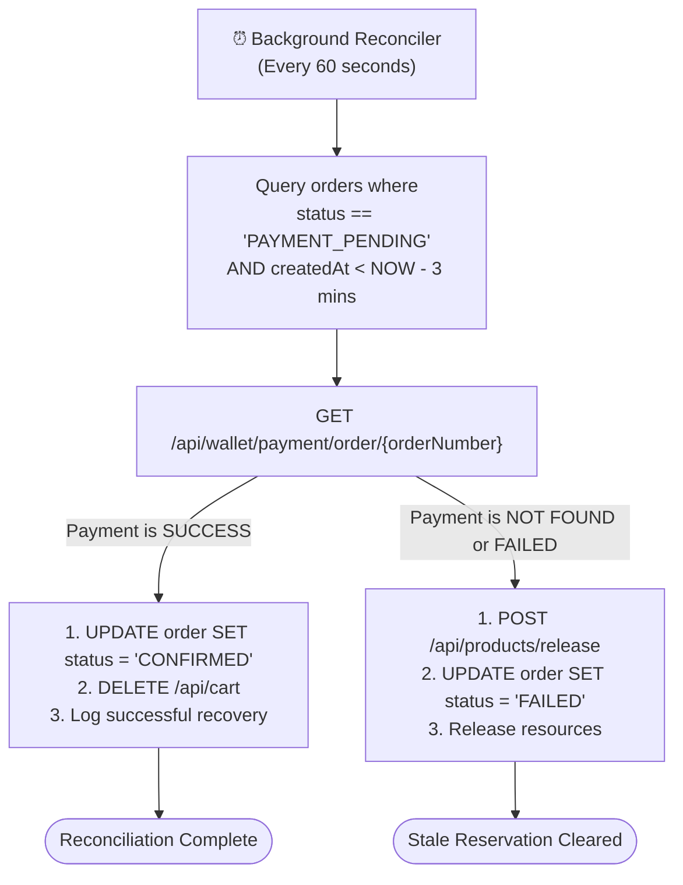

# Distributed Failure Handling, Crash Recovery & Reconciliation

## 1. Overview

In distributed architectures, failures are inevitable: services crash, network packets drop, databases experience transient lock contention, and remote dependencies timeout. E-ShoppingZone incorporates explicit fault containment, fail-close semantics, compensating mechanisms, and automated background reconciliation.

---

## 2. Failure Scenarios and Mitigations

| Failure Scenario | Impact | Mitigation Strategy | Compensating Action |
| :--- | :--- | :--- | :--- |
| **Product Service Unreachable during Cart Add** | User cannot add item to cart | Cart Service catches connection/read timeout; returns `503 Service Unavailable` with friendly error message | No database write committed in Cart Service |
| **Insufficient Stock during Checkout** | Checkout cannot proceed | Product Service rejects reservation with `400 Bad Request (INSUFFICIENT_STOCK)` | Order Service terminates checkout; Cart remains intact; no wallet debit attempted |
| **Wallet Balance Insufficient** | Checkout payment fails | Wallet Service rejects payment with `400 Bad Request (INSUFFICIENT_FUNDS)` | Order Service invokes `POST /api/products/release` to unreserve stock; Cart remains intact |
| **Order Service Crashes After Wallet Deduction** | Customer wallet was debited, but order persistence confirmation was lost | **Pre-Persistence State Machine**: Order was saved as `PAYMENT_PENDING` before debit. Client retry or background reconciler queries `GET /api/wallet/payment/order/{orderNumber}` to detect completed debit and finalize order as `CONFIRMED`. | Zero lost payments; idempotent retry confirmation |
| **Database Failure during Order Confirmation** | Order confirmation cannot be committed | Order Service catches `DataAccessException` in transactional block | Compensating refund call: `POST /api/wallet/refund`; Compensating release: `POST /api/products/release` |
| **Cart Cleanup Failure after Order Confirmation** | Order is saved, but cart still shows items | Non-fatal post-step: Order Service logs warning; returns confirmed order | Client UI resets cart locally; next cart load will see items already ordered or user can empty cart |
| **Downstream Microservice Slow (Thread Stalling)** | Potential thread pool exhaustion | Configured `connectTimeout(3000ms)` and `readTimeout(5000ms)` on all RestTemplates | Aborts hanging call and returns `504 Gateway Timeout` |
| **Invalid or Revoked Refresh Token Replay** | Attacker attempts to use stolen token | SHA-256 hash lookup detects already-revoked or non-existent token | System triggers proactive session revocation: invalidates all active refresh tokens for the user account |

---

## 3. Order Service Crash Reconciliation Flow

---

## 4. Idempotent Retry Policies

1. **Checkout Idempotency**:
   - The frontend generates an `idempotencyKey` (UUIDv4) upon entering the checkout confirmation step.
   - If a network glitch occurs and the user re-clicks "Place Order", the request resubmits the same key.
   - `Order Service` verifies if an order with that `idempotency_key` already exists:
     - If `CONFIRMED`, returns the existing order immediately.
     - If `PAYMENT_PENDING`, triggers immediate payment check with `Wallet Service` to either complete confirmation or fail cleanly.
2. **Wallet Payment Idempotency**:
   - `WalletTransaction` enforces a unique database constraint on `idempotency_key`.
   - Repeated attempts to deduct money using the same key return the existing transaction record rather than executing another withdrawal.
