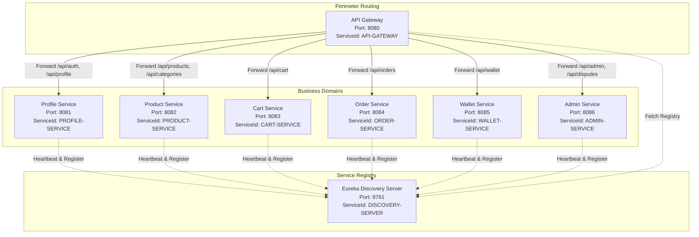

# Microservices Architecture Specification

## 1. Architectural Topology

E-ShoppingZone adopts an autonomous, decoupled microservices topology governed by domain boundaries. Every microservice is a self-contained Spring Boot application with its own build definition (`pom.xml`), configuration lifecycle, persistence store, domain model, and REST interfaces.

---

## 2. Service Inventory and Port Matrix

| Service Name | Spring Application Name | Default Port | Database | Primary Responsibility |
| :--- | :--- | :--- | :--- | :--- |
| **Discovery Server** | `discovery-server` | `8761` | None | Service Registry & Discovery via Netflix Eureka |
| **API Gateway** | `api-gateway` | `8080` | None | Edge Routing, Perimeter JWT Verification, CORS, Load Balancing |
| **Profile Service** | `profile-service` | `8081` | `profile_db` | Authentication (Local + GitHub OAuth), User & Merchant Profiles, Refresh Tokens |
| **Product Service** | `product-service` | `8082` | `product_db` | Product Catalog, Categorization, Merchant Ownership, Stock Reservation |
| **Cart Service** | `cart-service` | `8083` | `cart_db` | Customer Cart Management, Item Aggregation, Price Verification |
| **Order Service** | `order-service` | `8084` | `order_db` | Checkout Orchestration, Order Placement, Saga Compensation, Status History |
| **Wallet Service** | `wallet-service` | `8085` | `wallet_db` | Digital Wallet Ledger, Funds Deposit/Withdrawal, Payment Deduction |
| **Admin Service** | `admin-service` | `8086` | `admin_db` | Platform Governance, Merchant Verification, Dispute Mediation, SLA & Audit Logs |
| **Frontend UI** | `e-shopping-ui` | `5173` | Browser Storage | React 18 + TypeScript SPA |

---

## 3. Communication Patterns

### 3.1 External-to-Internal Communication
- **Protocol**: HTTP/1.1 REST JSON.
- **Entrypoint**: Single public ingress through API Gateway (`http://localhost:8080`).
- **Authentication**: JWT Bearer token passed in `Authorization: Bearer <token>` header for stateless requests; HttpOnly Secure cookie for refresh token endpoints.
- **Cross-Cutting Concerns**: Handled at Gateway layer (CORS headers, rate limiting, request correlation headers).

### 3.2 Internal Inter-Service Communication
- **Protocol**: Synchronous HTTP/1.1 over `@LoadBalanced RestTemplate`.
- **Naming Resolution**: Eureka logical service IDs (e.g. `http://PRODUCT-SERVICE/api/internal/...`).
- **Resilience**: Configured connect/read timeouts (3000ms connect, 5000ms read), structured error handler deserializing downstream `ErrorResponseDTO`.
- **Security Context Propagation**: Gateway or calling service propagates `X-User-Id`, `X-User-Roles`, and `X-Correlation-Id` across service boundaries.

---

## 4. Architectural Boundaries and Invariants

1. **Strict Data Isolation**: No service reads from or writes to another service's MySQL database. Direct SQL access across boundaries is prohibited.
2. **Authoritative Price Calculation**: Cart Service and Order Service never accept product prices provided by client requests. Prices must be retrieved authoritatively from `Product Service`.
3. **Double-Spend Prevention**: Wallet transactions use database-level pessimistic locking (`SELECT ... FOR UPDATE`) during deductions to prevent race conditions.
4. **Idempotent Order and Payment Processing**: Every payment and checkout request contains an idempotency key or client transaction reference to prevent duplicate charges or duplicate orders.

