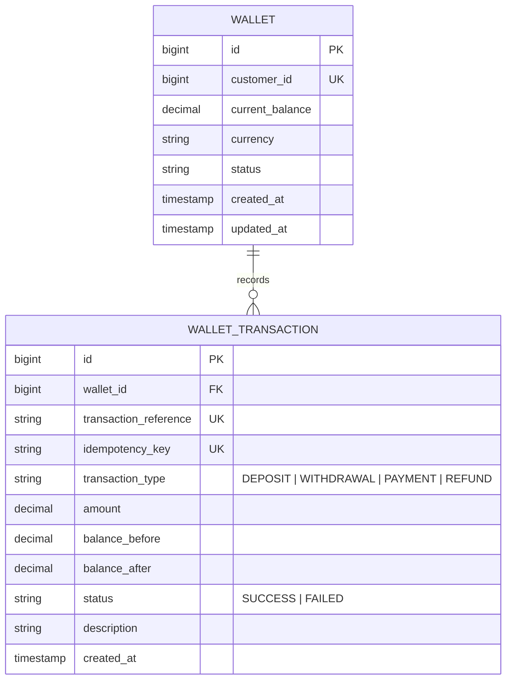
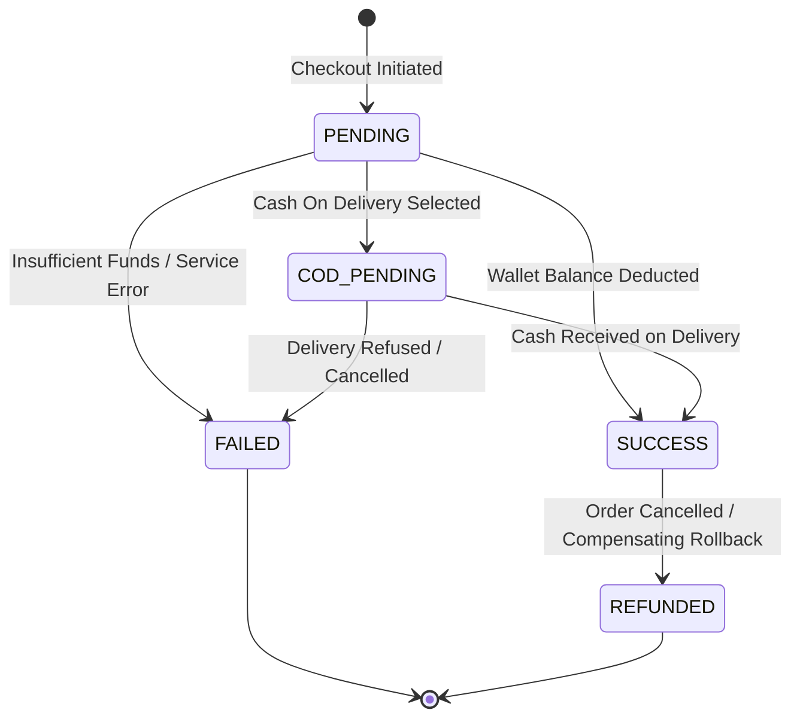

# Payment Flow & Financial Ledger Architecture

## 1. Overview

E-ShoppingZone supports two distinct payment mechanisms:
1. **Digital Wallet**: Pre-funded customer balance allowing instant debits, automatic refund rollbacks, and transaction ledger logging.
2. **Cash on Delivery (COD)**: Deferred payment model where funds are collected physically upon delivery, leaving order payment in `PENDING` status until marked collected.

All monetary values are strictly represented and calculated using `java.math.BigDecimal` with scale 2 (`RoundingMode.HALF_UP`) to prevent IEEE-754 floating-point inaccuracies.

---

## 2. Digital Wallet Ledger Architecture

The `Wallet Service` acts as an append-only double-entry-style ledger:
- `Wallet`: Represents the customer's current balance and wallet status (`ACTIVE`, `LOCKED`).
- `WalletTransaction`: Represents an immutable audit trail of every credit and debit event.



---

## 3. Concurrency & Idempotency Strategy

### 3.1 Pessimistic Locking
During wallet deductions (`POST /api/wallet/payment`), race conditions from concurrent checkout clicks could overdraw the customer's balance. To eliminate this risk:
```java
@Lock(LockModeType.PESSIMISTIC_WRITE)
@Query("SELECT w FROM Wallet w WHERE w.customerId = :customerId")
Optional<Wallet> findByCustomerIdForUpdate(@Param("customerId") Long customerId);
```
This forces MySQL to acquire an exclusive row-level lock (`SELECT ... FOR UPDATE`), ensuring sequential evaluation of balances.

### 3.2 Idempotency Key Handling
Every payment deduction request includes an `idempotencyKey` (UUID generated by the client or `Order Service`):
1. When a deduction request arrives, `Wallet Service` first checks whether a transaction with the same `idempotency_key` has already been recorded.
2. If already processed, the existing transaction DTO is returned immediately without double-debiting.
3. If new, the deduction proceeds under the pessimistic row lock.

---

## 4. Payment States & Transitions



