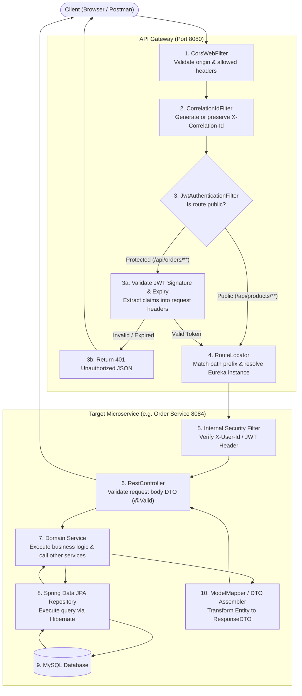

# Request Lifecycle Specification

## 1. Request Ingress & Gateway Flow

When an HTTP request originates from the React frontend or Postman client, it travels through a deterministic lifecycle across perimeter filters, edge routing, downstream security filters, controllers, service beans, repositories, and persistence databases.

---

## 2. Step-by-Step Execution Lifecycle

### Phase 1: Client Submission
- The React application sends an asynchronous request (via `axios` or `fetch`) targeting `http://localhost:8080/api/...`.
- If an access token exists in application memory, it is appended to the `Authorization` header (`Bearer eyJ...`).
- Cross-origin credentials (`withCredentials: true`) are enabled so that refresh token cookies are included.

### Phase 2: Edge Interception (Spring Cloud Gateway)
1. **CORS Evaluation**: Inflight preflight `OPTIONS` requests are validated against allowed origins (`http://localhost:5173`) and returned with required headers (`Access-Control-Allow-Credentials: true`).
2. **Correlation ID Injection**: A unique UUID is assigned to `X-Correlation-Id` if not already present.
3. **Route & Security Classification**:
   - Public paths (e.g., `/api/auth/login`, `/api/auth/register`, `/api/products/**`) pass directly without token verification.
   - Protected paths (e.g., `/api/cart/**`, `/api/orders/**`, `/api/wallet/**`) undergo reactive JWT signature verification using the shared HMAC secret.
   - If verification succeeds, user metadata is injected into internal forwarding headers:
     - `X-User-Id: 42`
     - `X-User-Email: user@example.com`
     - `X-User-Role: ROLE_CUSTOMER`
4. **Dynamic Routing**: Route predicate forwards the request to an instance resolved from Eureka (`lb://ORDER-SERVICE`).

### Phase 3: Service-Level Ingestion
1. **Context Initialization**: `UserContextFilter` reads internal headers (`X-User-Id`, `X-User-Role`) and establishes a `SecurityContext` in `ThreadLocal` storage.
2. **Controller Validation**: `@Valid` enforces JSR-380 constraints (e.g., `@NotNull`, `@Min`, `@Size`). Validation violations trigger `MethodArgumentNotValidException`, handled centrally by `@RestControllerAdvice`.
3. **Business Execution**: Domain services execute transactional state changes. Inter-service REST dependencies are called via `@LoadBalanced RestTemplate`.
4. **DTO Transformation**: Entities are mapped to immutable response DTOs, ensuring no internal database entities leak to the caller.
5. **Standardized Response**: The client receives a clean JSON payload with accurate HTTP status codes (`200 OK`, `201 Created`, `400 Bad Request`, `401 Unauthorized`, `403 Forbidden`, `404 Not Found`, `500 Internal Error`).

