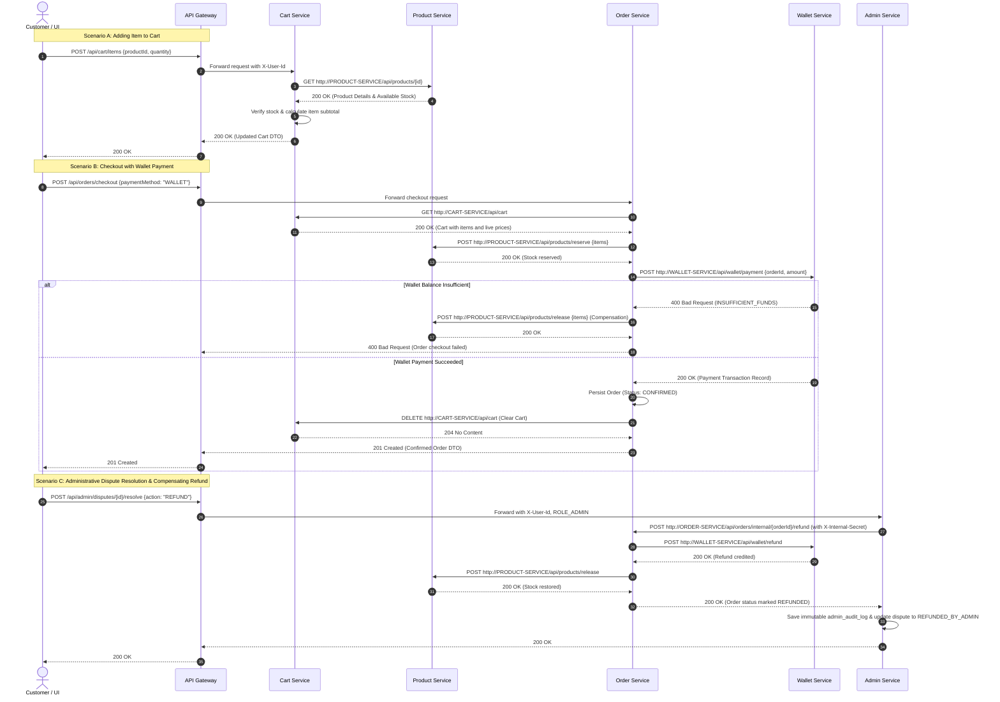

# Inter-Service Communication Specification

## 1. Overview

In accordance with the original specification, synchronous communication between microservices is implemented using **Spring `RestTemplate`** augmented with **Spring Cloud LoadBalancer** and **Eureka Service Discovery**.

No message brokers (such as Apache Kafka or RabbitMQ) or RPC frameworks (such as gRPC) are introduced, ensuring strict fidelity to the target technology stack while minimizing operational complexity.

---

## 2. Service Discovery Resolution

Microservices resolve remote service network locations dynamically using Eureka logical service names rather than hardcoded hostnames or IP addresses.

### 2.1 RestTemplate Bean Configuration
Each microservice that consumes external services registers a `@LoadBalanced` `RestTemplate` bean:

```java
@Configuration
public class RestClientConfig {

    @Bean
    @LoadBalanced
    public RestTemplate restTemplate(RestTemplateBuilder builder) {
        return builder
                .setConnectTimeout(Duration.ofMillis(3000))
                .setReadTimeout(Duration.ofMillis(5000))
                .interceptors(new CorrelationIdInterceptor(), new UserContextPropagationInterceptor())
                .errorHandler(new MicroserviceResponseErrorHandler())
                .build();
    }
}
```

---

## 3. Communication Matrix



---

## 4. Cross-Cutting Header Propagation

To ensure end-to-end traceability and security across distributed calls, `RestTemplate` interceptors propagate the following HTTP headers:

| Header Name | Injected By | Description | Example Value |
| :--- | :--- | :--- | :--- |
| `X-Correlation-Id` | API Gateway | Unique UUID identifying the end-to-end request lifecycle | `e9f78b1a-5b12-4f76-8092-23c34a6efc10` |
| `X-User-Id` | API Gateway | Authenticated user primary key extracted from JWT | `102` |
| `X-User-Email` | API Gateway | Authenticated user email extracted from JWT | `customer@example.com` |
| `X-User-Role` | API Gateway | Authenticated user role extracted from JWT | `ROLE_CUSTOMER` |
| `X-Internal-Secret` | Admin / Order Service | Shared cryptographic token securing internal inter-service endpoints | `ESHOPPING_INTERNAL_SECRET_2026` |

---

## 5. Resilience, Timeouts & Error Propagation

1. **Timeout Configuration**:
   - Connection Timeout: `3000ms` (3 seconds) to prevent thread exhaustion when remote services fail to accept sockets.
   - Read Timeout: `5000ms` (5 seconds) to prevent hanging threads during delayed database transactions.
2. **Error Translation (`MicroserviceResponseErrorHandler`)**:
   - Inter-service responses with 4xx and 5xx status codes are mapped to typed runtime exceptions (`DownstreamServiceException`, `ResourceNotFoundException`, `InsufficientStockException`).
   - Downstream error payloads (`ErrorResponseDTO`) are parsed, preserving the root error code and message.

