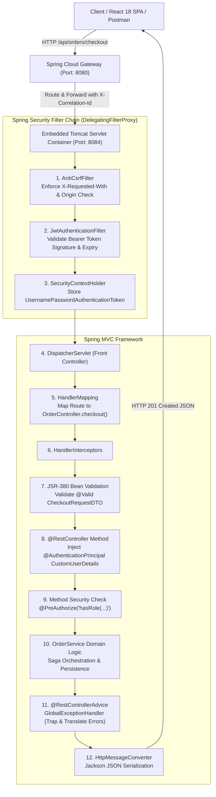
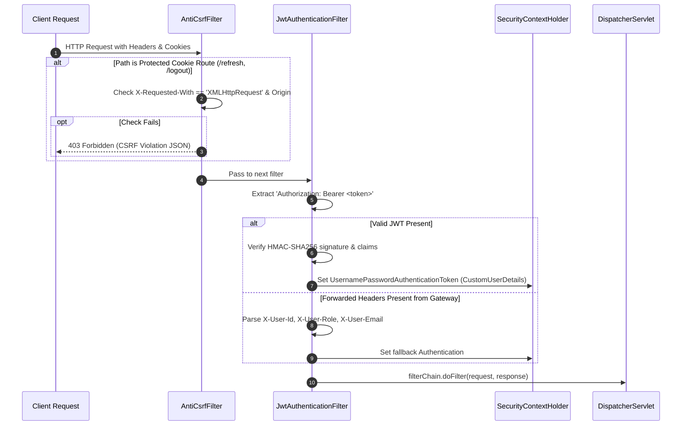

# Spring Security & Spring MVC Architecture Guide
### Applied Specifications for the E-ShoppingZone Microservices Platform

---

## 1. Executive Summary & Architectural Overview

In **E-ShoppingZone**, the backend microservices run as autonomous Spring Boot applications (`Java 8`, `Spring Boot 2.7.18`, `Spring Cloud 2021.0.9`). 

* **Spring Security** operates at the **Servlet Filter layer** (prior to the request reaching application code) to authenticate incoming requests, validate cryptographic HMAC-SHA256 JWT signatures, guard cookies against CSRF attacks, enforce stateless sessions, and manage role authorities.
* **Spring MVC** operates at the **Servlet & Controller layer** (`DispatcherServlet`) to map incoming REST endpoints, deserialize JSON request payloads, execute declarative Bean Validation (`@Valid`), invoke business logic, and serialize standardized JSON responses.



---

## 2. Spring Security in E-ShoppingZone

Spring Security is configured across all microservices using a centralized Java configuration extending `WebSecurityConfigurerAdapter`:
* **Profile Service**: [SecurityConfig.java](file:///c:/Users/varshj/OneDrive%20-%20Capgemini/Desktop/E_Shopping_Zone/backend/profile-service/src/main/java/com/eshopping/profile/config/SecurityConfig.java)
* **Order Service**: [SecurityConfig.java](file:///c:/Users/varshj/OneDrive%20-%20Capgemini/Desktop/E_Shopping_Zone/backend/order-service/src/main/java/com/eshopping/order/config/SecurityConfig.java)
* **Admin Service**: [SecurityConfig.java](file:///c:/Users/varshj/OneDrive%20-%20Capgemini/Desktop/E_Shopping_Zone/backend/admin-service/src/main/java/com/eshopping/admin/config/SecurityConfig.java)
* **Product, Cart & Wallet Services**: Respective `config/SecurityConfig.java` files.

### 2.1 Stateless Session Management (`SessionCreationPolicy.STATELESS`)
Because E-ShoppingZone is a distributed microservices platform, the server never creates or maintains an in-memory `HttpSession`. Each HTTP request is authenticated independently via cryptographic tokens:
```java
http
    .sessionManagement()
        .sessionCreationPolicy(SessionCreationPolicy.STATELESS);
```
* **Architectural Advantage**: Prevents server memory bloat, enables instant horizontal scaling across instances without sticky sessions, and avoids distributed session clustering overhead (such as Redis or Hazelcast).

---

### 2.2 Custom Security Filter Pipeline
Spring Security delegates request processing to a custom chain of `OncePerRequestFilter` components registered before the standard `UsernamePasswordAuthenticationFilter`:



#### A. Anti-CSRF Guard (`AntiCsrfFilter.java`)
* **Source**: [AntiCsrfFilter.java](file:///c:/Users/varshj/OneDrive%20-%20Capgemini/Desktop/E_Shopping_Zone/backend/profile-service/src/main/java/com/eshopping/profile/security/AntiCsrfFilter.java)
* **Target Endpoints**: Cookie-bearing endpoints (`/api/auth/refresh`, `/api/auth/logout`, `/api/auth/logout-all`).
* **Protection Mechanism**: Requires `X-Requested-With: XMLHttpRequest` and validates the `Origin` header against `http://localhost:5173` and `http://localhost:8080`.
* **Why**: Standard web browsers and cross-site HTML forms cannot inject custom headers across origins without triggering a CORS preflight check, effectively stopping CSRF attacks without stateful synchronizer tokens.

#### B. JWT Authentication Filter (`JwtAuthenticationFilter.java`)
* **Source**: [JwtAuthenticationFilter.java](file:///c:/Users/varshj/OneDrive%20-%20Capgemini/Desktop/E_Shopping_Zone/backend/profile-service/src/main/java/com/eshopping/profile/security/JwtAuthenticationFilter.java)
* **Mechanism**:
  1. Intercepts incoming `Authorization: Bearer <token>` header.
  2. Validates HMAC signature against the shared secret (`JWT_SECRET`) and checks expiration (15 minutes).
  3. Parses claims: `userId`, `email`, and `roles`.
  4. Wraps identity in `CustomUserDetails` and sets it inside `SecurityContextHolder.getContext().setAuthentication(auth)`.
  5. In downstream domain services (`order-service`, `product-service`, `cart-service`, `wallet-service`, `admin-service`), the filter parses the token statelessly or resolves trusted gateway headers (`X-User-Id`, `X-User-Role`) **without querying `profile_db`**.

---

### 2.3 Password Hashing (`BCryptPasswordEncoder`)
* **Configuration**:
  ```java
  @Bean
  public PasswordEncoder passwordEncoder() {
      return new BCryptPasswordEncoder(10); // 10 rounds = 1024 hashing cycles
  }
  ```
* **Security Principles**:
  * Incorporates a 128-bit cryptographic random salt automatically inside each generated hash string.
  * Computationally intensive (work factor 10) to mitigate offline brute-force and GPU rainbow table attacks.
  * Employs constant-time string comparison during `matches()` to eliminate timing attack side-channels.

---

### 2.4 Headless REST Exception Handlers (401 & 403)
Default Spring Security filters redirect unauthorized browser traffic to `/login` HTML pages. In our headless REST architecture, custom handlers return structured JSON payloads:
* **[RestAuthenticationEntryPoint.java](file:///c:/Users/varshj/OneDrive%20-%20Capgemini/Desktop/E_Shopping_Zone/backend/profile-service/src/main/java/com/eshopping/profile/security/RestAuthenticationEntryPoint.java)**:
  Returns HTTP `401 Unauthorized` with JSON error code `UNAUTHORIZED` when credentials are absent or expired.
* **[RestAccessDeniedHandler.java](file:///c:/Users/varshj/OneDrive%20-%20Capgemini/Desktop/E_Shopping_Zone/backend/profile-service/src/main/java/com/eshopping/profile/security/RestAccessDeniedHandler.java)**:
  Returns HTTP `403 Forbidden` with JSON error code `ACCESS_DENIED` when an authenticated user lacks the required role.

---

### 2.5 Role-Based Authorization & Method Security
In addition to route ant-matchers configured in `HttpSecurity`, method-level security is enabled via:
```java
@EnableGlobalMethodSecurity(prePostEnabled = true)
```

Controllers enforce permissions and ownership declaratively:
* `@PreAuthorize("hasRole('ADMIN')")`: Restricted to administrators (e.g. [AdminController.java](file:///c:/Users/varshj/OneDrive%20-%20Capgemini/Desktop/E_Shopping_Zone/backend/admin-service/src/main/java/com/eshopping/admin/controller/AdminController.java#L23) for merchant approvals, dispute arbitration, and audit logs).
* `@PreAuthorize("hasRole('MERCHANT')")`: Restricted to verified merchants for catalog CRUD operations.
* `@PreAuthorize("hasRole('CUSTOMER') or isAuthenticated()")`: Restricted to authenticated shoppers for cart, checkout, and dispute creation.
* `@AuthenticationPrincipal CustomUserDetails userDetails`: Injected directly into controller method parameters for safe, zero-leakage identity binding.

---

## 3. Spring MVC in E-ShoppingZone

Spring MVC manages the presentation and HTTP dispatching layer across all microservices.

### 3.1 Front Controller Pattern (`DispatcherServlet`)
Every microservice embeds an Apache Tomcat web container where Spring's `DispatcherServlet` coordinates the MVC lifecycle:
1. Receives requests passed down from the Spring Security Filter Chain.
2. Queries `RequestMappingHandlerMapping` to match HTTP method and URI with the appropriate controller.
3. Invokes `HandlerAdapter` to bind parameters (`@RequestBody`, `@PathVariable`, `@RequestParam`).
4. Executes controller logic.
5. Invokes Jackson `HttpMessageConverter` to write the JSON response body directly.

---

### 3.2 Declarative Input Validation (JSR-380 / Bean Validation)
Incoming client payloads are mapped to strongly-typed Data Transfer Objects (DTOs) and validated before executing domain code:
* **Controller Level Trigger**:
  ```java
  @PostMapping("/checkout")
  public ResponseEntity<ApiResponse<OrderResponseDTO>> checkout(
          @Valid @RequestBody CheckoutRequestDTO request,
          @AuthenticationPrincipal CustomUserDetails userDetails) { ... }
  ```
* **Validation Annotations Applied**:
  * `@NotBlank(message = "Field cannot be blank")`: Rejects null, empty, or whitespace strings.
  * `@Email(message = "Invalid email format")`: Validates RFC 5322 email patterns.
  * `@Pattern(regexp = "^(?=.*[0-9])(?=.*[a-z])...")`: Enforces strong password criteria.
  * `@DecimalMin(value = "0.01")`: Enforces strictly positive monetary amounts.
  * `@NotNull(message = "Field is required")`: Validates object references and enums.

---

### 3.3 Centralized Error Handling (`@RestControllerAdvice`)
Instead of wrapping individual controller methods in `try/catch` blocks, all microservices implement a centralized `@RestControllerAdvice` class:
* **Source**: [GlobalExceptionHandler.java](file:///c:/Users/varshj/OneDrive%20-%20Capgemini/Desktop/E_Shopping_Zone/backend/profile-service/src/main/java/com/eshopping/profile/exception/GlobalExceptionHandler.java)

1. **Handling Validation Constraints (`MethodArgumentNotValidException`)**:
   When `@Valid` triggers a violation, Spring interrupts execution and throws `MethodArgumentNotValidException`. The global advice collects field-level messages from `BindingResult` and builds a structured `400 Bad Request` response:
   ```json
   {
     "status": 400,
     "error": "VALIDATION_FAILED",
     "message": "Validation constraints failed",
     "fieldErrors": [
       { "field": "email", "message": "Invalid email address format" }
     ],
     "correlationId": "a189f213-909d-4762-b118-20da5943ebc1"
   }
   ```
2. **Handling Domain Business Exceptions**:
   Custom domain exceptions (e.g., `InsufficientStockException`, `InvalidCredentialsException`, `DisputeNotFoundException`) are caught and mapped to standard HTTP statuses (`400`, `401`, `404`, `409`).
3. **Traceability Correlation**:
   The exception handler reads the `X-Correlation-Id` header from the active `HttpServletRequest` and attaches it to the error envelope, ensuring distributed tracing continuity.

---

### 3.4 Message Conversion & Serialization
Spring MVC uses `MappingJackson2HttpMessageConverter`:
* **JSON Marshalling**: Parses JSON payloads into Java DTOs and serializes `ResponseEntity<ApiResponse<T>>` envelopes into JSON.
* **Monetary Precision**: All currency amounts are serialized as exact `BigDecimal` numbers (preventing floating-point truncation).
* **ISO 8601 Timestamps**: Java 8 `LocalDateTime` instances are formatted cleanly as ISO strings (`yyyy-MM-dd'T'HH:mm:ss`).

---

### 3.5 Inter-Service HTTP Context Propagation (`RestTemplate`)
When Spring MVC services act as HTTP clients to call peer services, a customized `@LoadBalanced RestTemplate` is used:
* **`CorrelationIdInterceptor`**: Injects `X-Correlation-Id` into downstream request headers.
* **`UserContextPropagationInterceptor`**: Injects `X-User-Id`, `X-User-Role`, and `X-User-Email` into downstream headers.
* **`MicroserviceResponseErrorHandler`**: Intercepts downstream 4xx and 5xx responses, deserializing downstream `ErrorResponseDTO` into typed runtime exceptions.

---

## 4. Architectural Comparison: Spring Security vs. Spring MVC

| Feature | Spring Security | Spring MVC |
| :--- | :--- | :--- |
| **Execution Layer** | Servlet Filter Chain (Before `DispatcherServlet`) | Inside `DispatcherServlet` & Controller hierarchy |
| **Primary Domain** | Authentication, Authorization, CSRF, Token Verification | Route mapping, DTO binding, Validation, JSON Serialization |
| **Key Base Classes** | `WebSecurityConfigurerAdapter`, `OncePerRequestFilter` | `@RestController`, `@RequestMapping`, `@RestControllerAdvice` |
| **Thread Context** | `SecurityContextHolder` (`Authentication`) | `RequestContextHolder` (`ServletRequestAttributes`) |
| **Security Exceptions** | `AuthenticationEntryPoint` (401), `AccessDeniedHandler` (403) | `@ExceptionHandler` / `@RestControllerAdvice` (400, 404, 500) |
| **Data Handled** | JWT headers, HTTP Cookies, Authorities / Roles | Path variables, Request query params, Request body DTOs |

---

## 5. Viva / Evaluation Quick-Reference Questions

### Q1: Why do we configure `SessionCreationPolicy.STATELESS` in our microservices?
> **Answer**: In a microservices architecture, requests are distributed across multiple service instances by Eureka and Spring Cloud Gateway. Using stateless sessions guarantees that no server-side `HttpSession` exists. Every request carries its own cryptographic credentials (JWT Bearer token), eliminating session replication overhead and enabling horizontal scaling.

### Q2: What is the benefit of `@AuthenticationPrincipal` over reading headers manually?
> **Answer**: `@AuthenticationPrincipal` is a type-safe Spring Security parameter resolver that pulls the authenticated principal directly from the thread-local `SecurityContextHolder`. It decouples business controllers from raw `HttpServletRequest` headers, simplifies unit testing without mocking HTTP requests, and ensures that only validated user identities reach domain logic.

### Q3: How does Spring MVC validate incoming request bodies, and how are errors formatted?
> **Answer**: Spring MVC uses Java Bean Validation (JSR-380). The controller method annotates the DTO with `@Valid`. If constraints like `@NotBlank` or `@Email` are violated, Spring interrupts execution and throws `MethodArgumentNotValidException`. Our `@RestControllerAdvice` (`GlobalExceptionHandler`) intercepts this exception, extracts all field-level errors from the `BindingResult`, and returns a standardized `400 Bad Request` JSON envelope.

### Q4: Why is `AntiCsrfFilter` necessary if `http.csrf().disable()` is called?
> **Answer**: `http.csrf().disable()` disables Spring's default stateful CSRF token mechanism because our main API uses stateless JWT Bearer tokens in headers (which browsers do not attach automatically, making them immune to CSRF). However, endpoints like `/api/auth/refresh` and `/api/auth/logout` use `HttpOnly` browser cookies. To prevent cross-site request forgery against these cookie endpoints, we implemented `AntiCsrfFilter`, which strictly enforces the `X-Requested-With: XMLHttpRequest` header and verifies origin headers before processing cookie requests.
