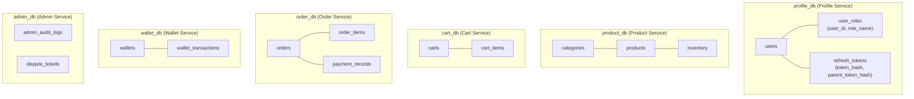

# Database Architecture Overview

## 1. Design Principles

E-ShoppingZone implements the **Database-per-Service** pattern to maintain strict decoupling between microservice domains.

### Core Rules:
1. **Isolated Ownership**: Each microservice exclusively owns its schema and tables. No service is permitted to query or mutate tables belonging to another microservice.
2. **Logical Hosting**: For local development, all databases reside on a single MySQL 8.0 instance (port `3306`), accessible via dedicated logical database names.
3. **No Cross-Database Foreign Keys**: Referential integrity is enforced within each service's boundary. Cross-service relationships (such as `user_id` inside `orders` or `product_id` inside `order_items`) are stored as scalar identifiers and resolved at the application layer via REST calls.
4. **Monetary Precision**: All monetary values (`price`, `subtotal`, `grand_total`, `balance`, `amount`) are stored as `DECIMAL(12, 2)` to eliminate floating-point rounding errors.
5. **Audit Timestamps**: All entities carry `created_at` and `updated_at` timestamps populated via JPA lifecycle callbacks or MySQL defaults.

---

## 2. Complete Database & Table Inventory

| Database Name | Owning Microservice | Table Name | Primary Columns & Constraints | Purpose |
| :--- | :--- | :--- | :--- | :--- |
| `profile_db` | Profile Service | `users` | `id` (PK), `email` (UK), `password_hash`, `full_name`, `phone_number`, `auth_provider`, `github_id` (UK), `enabled` | User accounts, credentials & personal profiles |
| `profile_db` | Profile Service | `user_roles` | `user_id` (PK, FK), `role_name` (PK) (`ROLE_CUSTOMER`, `ROLE_MERCHANT`) | Composite PK table mapping users to authorized roles |
| `profile_db` | Profile Service | `refresh_tokens` | `id` (PK), `user_id` (FK), `token_hash` (UK), `parent_token_hash`, `expiry_date`, `revoked` | Opaque refresh tokens with lineage tracking |
| `product_db` | Product Service | `categories` | `id` (PK), `name` (UK), `slug` (UK), `description`, `image_url` | Catalog categorization hierarchy |
| `product_db` | Product Service | `products` | `id` (PK), `merchant_id`, `category_id` (FK), `name`, `sku` (UK), `price`, `active` | Product specifications and merchant ownership |
| `product_db` | Product Service | `inventory` | `id` (PK), `product_id` (UK, FK), `available_stock`, `reserved_stock`, `version` | Authoritative stock & optimistic lock tracking |
| `cart_db` | Cart Service | `carts` | `id` (PK), `customer_id` (UK) | Customer cart session anchor |
| `cart_db` | Cart Service | `cart_items` | `id` (PK), `cart_id` (FK), `product_id`, `quantity`, UK(`cart_id`, `product_id`) | Line items placed in customer shopping cart |
| `order_db` | Order Service | `orders` | `id` (PK), `order_number` (UK), `idempotency_key` (UK), `customer_id`, `order_status`, `payment_method`, `total_amount` | Master order records & lifecycle state |
| `order_db` | Order Service | `order_items` | `id` (PK), `order_id` (FK), `product_id`, `product_name_snapshot`, `unit_price_snapshot`, `quantity` | Immutable price and product name purchase snapshots |
| `order_db` | Order Service | `payment_records`| `id` (PK), `order_id` (FK), `payment_reference` (UK), `amount`, `status` | Audit trail of payment transactions per order |
| `wallet_db` | Wallet Service | `wallets` | `id` (PK), `customer_id` (UK), `current_balance`, `currency`, `status`, `version` | Customer digital currency balance |
| `wallet_db` | Wallet Service | `wallet_transactions`| `id` (PK), `wallet_id` (FK), `transaction_reference` (UK), `idempotency_key` (UK), `transaction_type`, `amount`, `balance_after` | Immutable ledger of all deposits, deductions, refunds |
| `admin_db` | Admin Service | `admin_audit_logs` | `id` (PK), `admin_id`, `admin_email`, `action_type`, `target_entity_type`, `target_entity_id`, `reason`, `ip_address`, `created_at` | Immutable audit trail of governance actions, merchant bans, and dispute overrides |
| `admin_db` | Admin Service | `dispute_tickets` | `id` (PK), `order_id` (UK), `customer_id`, `merchant_id`, `issue_reason`, `refund_amount`, `status`, `merchant_deadline`, `escalated_at`, `resolved_at` | Customer-merchant order dispute tickets with 2-minute SLA and auto-escalation |

---

## 3. High-Level Schema Architecture

