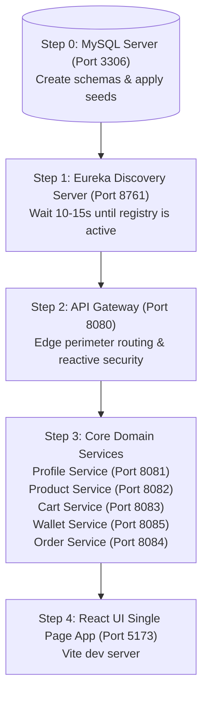

# Service Startup Order & Dependency Sequencing

## 1. Prescribed Startup Sequence

Because downstream services register with Eureka and the API Gateway queries Eureka for dynamic routes, services must be launched in the exact sequence outlined below:

---

## 2. Health Verification Checklist

1. **Verify MySQL**: Ensure port `3306` is open and databases `profile_db`, `product_db`, `cart_db`, `order_db`, and `wallet_db` exist.
2. **Verify Eureka Dashboard**: Open `http://localhost:8761`. Verify that `API-GATEWAY`, `PROFILE-SERVICE`, `PRODUCT-SERVICE`, `CART-SERVICE`, `ORDER-SERVICE`, and `WALLET-SERVICE` appear with status `UP (1)`.
3. **Verify Gateway Routing**: Invoke `http://localhost:8080/api/products` and confirm public product listing is returned.
4. **Verify React UI**: Open `http://localhost:5173` and confirm the homepage renders catalog products cleanly.

