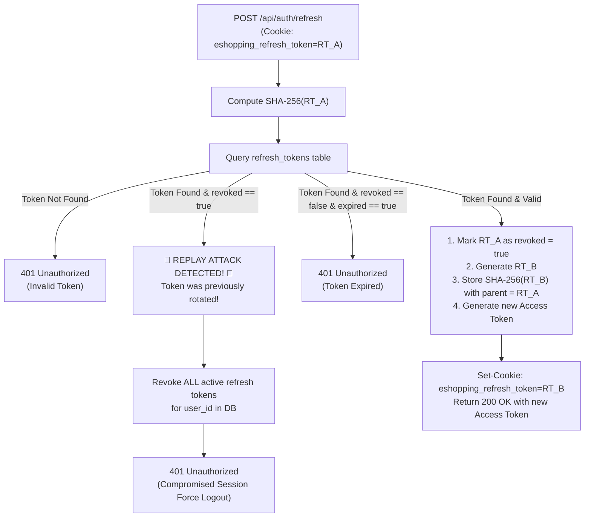

# Refresh Token Rotation (RTR) & Replay Attack Detection

## 1. Refresh Token Rotation (RTR) Mechanics

Refresh Token Rotation ensures that whenever a refresh token is presented to `/api/auth/refresh` to obtain a new access token, the current refresh token is immediately invalidated, and a completely new refresh token is issued.



---

## 2. Replay Attack Detection Scenario

1. **Legitimate User Flow**:
   - User has `Token_1`.
   - User refreshes: `Token_1` is marked `revoked=true`. User receives `Token_2`.
2. **Attacker Interception**:
   - Adversary stole a copy of `Token_1` earlier.
   - Adversary attempts to call `/api/auth/refresh` with `Token_1`.
3. **Detection & Defense**:
   - Profile Service finds `Token_1` with `revoked == true`.
   - This indicates a replay attack (either the legitimate client or the attacker is using an expired/stolen token).
   - Profile Service executes:
     ```sql
     UPDATE refresh_tokens SET revoked = TRUE WHERE user_id = :userId;
     ```
   - Profile Service returns `401 Unauthorized` with error code `REFRESH_TOKEN_REUSED`.
   - The legitimate user's active session is terminated, forcing re-authentication, while the adversary is immediately denied access.

