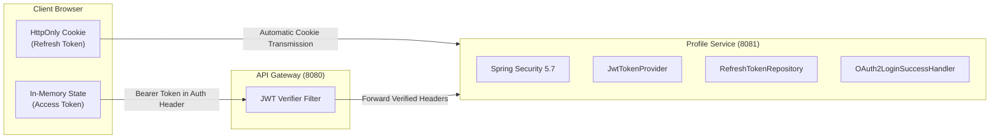

# Security Architecture Overview

## 1. Threat Model & Security Posture

E-ShoppingZone adopts a defense-in-depth security model designed to mitigate common web application threats (OWASP Top 10) in a distributed microservices environment.

### Threat Mitigation Matrix

| Threat Category | Potential Impact | Architecture Mitigation |
| :--- | :--- | :--- |
| **XSS Token Theft** | Stolen credentials allowing account takeover | Refresh tokens delivered exclusively in `HttpOnly` cookies. Access tokens stored in React memory only, never in `localStorage` or `sessionStorage`. |
| **Token Replay Attacks** | Replaying intercepted refresh tokens | Refresh Token Rotation (RTR). Storing tokens as SHA-256 hashes. Detection of rotated token reuse triggers immediate revocation of all user sessions. |
| **Unauthorized Endpoint Access** | Bypassing perimeter controls | Two-tier enforcement: Edge reactive JWT validation at API Gateway + downstream method/filter-level authority checks. |
| **Insecure Direct Object Reference (IDOR)** | Merchant tampering with another merchant's catalog | Domain service verification ensuring `product.merchantId == authenticatedUserId`. |
| **Credential Cracking** | Brute-force and offline rainbow table attacks | Passwords hashed using BCrypt with salt factor 10. Timing-safe verification prevents timing side-channels. |
| **Price Tampering** | Manipulating line item prices in transit | Cart and Order services query authoritative product prices directly from `Product Service`. Client-submitted prices are ignored. |
| **Double-Spending / Race Conditions** | Overdrawing wallet balance via concurrent clicks | Pessimistic database row locking (`SELECT ... FOR UPDATE`) and unique transaction idempotency keys. |

---

## 2. Authentication Architecture

