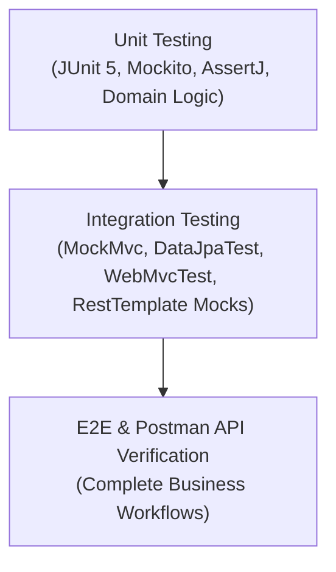

# Testing Strategy & Traceable Quality Framework

## 1. Test Pyramid & Automation Levels

E-ShoppingZone enforces rigorous testing at each level of the software engineering pyramid:

---

## 2. Test Scope Matrix

| Layer | Tools | Scope | Target Coverage |
| :--- | :--- | :--- | :--- |
| **Unit Tests** | JUnit 5, Mockito | Service business logic, token generators, cart math, validator classes | > 80% Branch Coverage |
| **Slice Integration** | `@WebMvcTest`, `MockMvc` | Controller endpoint mapping, DTO validation, status codes, CORS headers | All Controllers |
| **Persistence Tests** | `@DataJpaTest` | Custom repository queries, unique constraints, entity cascade behaviors | All Custom Queries |
| **Security Tests** | `spring-security-test` | Unauthenticated rejection, RBAC restrictions, refresh token replay | All Protected Endpoints |
| **API End-to-End** | Postman / Newman | End-to-end registration -> login -> browse -> cart -> checkout -> wallet ledger | 100% of PDF Use Cases |

---

## 3. Traceable Acceptance Criteria Checklist (37 Items)

| ID | Acceptance Criterion | Verification Method |
| :--- | :--- | :--- |
| **AC-01** | Original Capgemini PDF requirements implemented | Specification Audit |
| **AC-02** | Pure Java 8 bytecode compatibility verified | Maven Compiler Check |
| **AC-03** | Spring Boot 2.7.x framework baseline verified | Dependency Tree Audit |
| **AC-04** | All seven backend Spring Boot applications exist independently | Project Structure Check |
| **AC-05** | Netflix Eureka registration works for all services | Eureka Dashboard (`:8761`) |
| **AC-06** | Spring Cloud Gateway routing works as single ingress (`:8080`) | Gateway Route Tests |
| **AC-07** | Profile registration works with BCrypt password hashing | Unit & Postman Tests |
| **AC-08** | Email/password login returns JWT and sets refresh cookie | Postman Login Test |
| **AC-09** | JWT access-token validation works at Gateway and downstream | Security Filter Tests |
| **AC-10** | Refresh Token Rotation (RTR) works on every renewal | Integration Tests |
| **AC-11** | Replay attack detection revokes all user sessions | Security Replay Tests |
| **AC-12** | Logout endpoint clears cookie and revokes refresh token | Postman Logout Test |
| **AC-13** | GitHub OAuth 2.0 social login works with credentials | OAuth Redirect & Flow |
| **AC-14** | Customer (`ROLE_CUSTOMER`) and Merchant (`ROLE_MERCHANT`) roles work | RBAC Unit & HTTP Tests |
| **AC-15** | Merchant product management (CRUD, ownership isolation) works | Product Integration Tests |
| **AC-16** | Unauthenticated product search and filtering works | Public Search Tests |
| **AC-17** | Cart operations (add, update quantity, remove, view totals) work | Cart Service Tests |
| **AC-18** | Digital wallet balance and ledger operations work | Wallet Service Tests |
| **AC-19** | Duplicate wallet deductions prevented via pessimistic lock & idempotency | Concurrency Test Suite |
| **AC-20** | Checkout Saga works (stock reserve, wallet debit, order persist) | Distributed Saga Tests |
| **AC-21** | Cash on Delivery (COD) order checkout works | COD Workflow Tests |
| **AC-22** | Customer order history and merchant order visibility work | Order Controller Tests |
| **AC-23** | React UI communicates exclusively through API Gateway | Frontend Network Logs |
| **AC-24** | Every microservice exposes Springdoc OpenAPI 1.8.x Swagger UI | Swagger UI Endpoints |
| **AC-25** | Swagger JWT Bearer authentication works on protected endpoints | Swagger UI Testing |
| **AC-26** | MySQL schemas and tables are correctly partitioned per service | DDL Verification Script |
| **AC-27** | Database initialization and seed scripts execute cleanly | MySQL CLI Execution |
| **AC-28** | Meaningful unit tests exist across all services | JUnit 5 Test Run |
| **AC-29** | Controller & JPA integration tests exist | MockMvc & DataJpaTest |
| **AC-30** | Security test suite tests unauthorized access, replay, IDOR | Security Integration Tests |
| **AC-31** | Postman collections covering all workflows exist and pass | Newman CLI Execution |
| **AC-32** | Comprehensive `README.md` exists with clear instructions | File Audit |
| **AC-33** | Architecture documentation with Mermaid diagrams exists | `docs/architecture/` Audit |
| **AC-34** | Database documentation with ER diagrams exists | `docs/database/` Audit |
| **AC-35** | API contract documentation with DTOs exists | `docs/api/` Audit |
| **AC-36** | Security documentation (JWT, RTR, CSRF, CSP) exists | `docs/security/` Audit |
| **AC-37** | Zero Docker / Kubernetes dependency required for local execution | Bare-Metal Verification |
